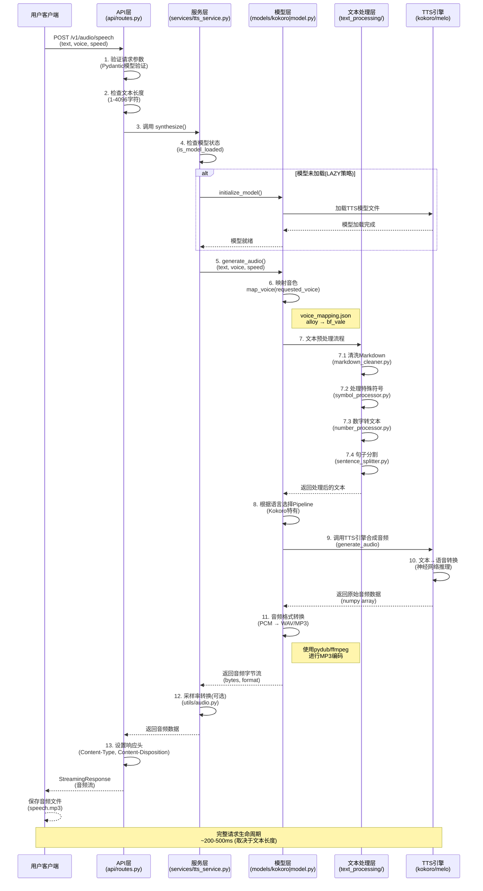

# TTS Service

Text-to-Speech service with OpenAI API compatibility, supporting multiple TTS models (Kokoro and MeloTTS).

## 特性

- ✅ **模型可插拔** - 切换模型只需修改配置
- ✅ **OpenAI 兼容** - 完全兼容 OpenAI TTS API
- ✅ **多格式支持** - MP3 和 WAV 音频格式
- ✅ **WebSocket 流式** - 实时流式语音合成
- ✅ **Markdown 支持** - 自动清洗 Markdown 格式
- ✅ **中英双语** - 完整的中英文混合支持
- ✅ **RESTful API** - 简单易用的 HTTP 接口
- ✅ **健康监控** - 内置健康检查端点

## 快速开始

### 1. 安装依赖

```bash
cd TTS_Service

# 安装共享依赖
pip install -r requirements.txt

# 安装 Kokoro 模型依赖
pip install -r requirements-kokoro.txt

# 或安装 MeloTTS 模型依赖
pip install -r requirements-melo.txt
```

详细安装说明：[Kokoro 部署指南](docs/01_deployment_kokoro.md) | [MeloTTS 部署指南](docs/02_deployment_melo.md)

### 2. 配置文件

复制示例配置文件：

```bash
cp .env.example .env
```

编辑 `.env` 文件选择模型：

```ini
# 选择模型：kokoro 或 melo
TTS_MODEL=kokoro

# 服务器配置
HOST=0.0.0.0
PORT=9880
```

### 3. 启动服务

```bash
# 激活 conda 环境
conda activate kokoro

# 启动服务
python main.py

# 或使用启动脚本
start_service.bat
```

服务将在 `http://0.0.0.0:9880` 启动。

## 接口调用方式

本服务提供两种音频生成模式：**非流式**和**流式**。

### 模式对比

| 特性 | 非流式模式 | 流式模式 |
|------|-----------|---------|
| **接口** | HTTP POST (`/v1/audio/speech`) | WebSocket (`/ws/tts`) |
| **返回方式** | 一次性返回完整音频 | 逐句返回音频块 |
| **响应时间** | 需等待全部生成完成 | 首句音频快速返回 |
| **分句处理** | ✅ 后台分句，最后合并 | ✅ 逐句发送，实时输出 |
| **适用场景** | 短文本、离线生成 | 长文本、实时播放 |
| **首字节延迟** | 较高（~2-5秒） | 低（~500ms） |
| **用户体验** | 等待时间长 | 即时反馈 |
| **资源占用** | 内存占用较高（需缓存全部音频） | 内存占用较低（流式处理） |

### 模式选择建议

- **非流式模式** 适合：
  - 短文本（< 200 字符）
  - 需要完整音频文件保存
  - 批量处理
  - 离线下载场景

- **流式模式** 适合：
  - 长文本（> 200 字符）
  - 实时语音播放
  - 在线朗读应用
  - 需要即时反馈的场景

### 分句处理说明

**重要**：两种模式都会进行分句处理，每个句子会：
1. 自动添加标点符号（如果末尾没有标点）
2. 独立选择最优音色
3. 单独生成音频
4. 最后合并输出

**日志输出示例**（Kokoro 模型）：
```
[Sentence 1/2] Sending to TTS: 'Hello world.' (voice: af_maple)
[Sentence 2/2] Sending to TTS: 'This is a test.' (voice: af_maple)
```

### OpenAI 兼容 TTS 接口（非流式模式）

**这是非流式模式的接口**，适合短文本和离线生成。

**端点**: `POST /v1/audio/speech`

**请求示例**:
```bash
curl -X POST http://localhost:9880/v1/audio/speech \
  -H "Content-Type: application/json" \
  -d '{
    "model": "tts-1",
    "input": "Hello, world!",
    "voice": "alloy",
    "response_format": "mp3",
    "speed": 1.0
  }' \
  --output speech.mp3
```

**请求参数**:
- `model`: 模型名称（固定为 "tts-1"）
- `input`: 输入文本（1-4096 字符）
- `voice`: 音色选择
  - Kokoro: `alloy`, `echo`, `fable`, `onyx`, `nova`, `shimmer`
  - MeloTTS: `alloy`（中英双语）, `echo`（美式英语）, `fable`（英式英语）, `onyx`, `nova`, `shimmer`（澳式英语）
- `response_format`: 音频格式（`mp3` 或 `wav`）
- `speed`: 语速（0.25-4.0）

### 简单 TTS 接口（非流式模式）

**这是非流式模式的简化接口**，使用更简单。

**端点**: `GET /tts`

```bash
curl "http://localhost:9880/tts?text=你好世界&voice=alloy" --output output.wav
```

**端点**: `POST /tts_post`

```bash
curl -X POST http://localhost:9880/tts_post \
  -H "Content-Type: application/json" \
  -d '{
    "text": "你好世界",
    "voice": "alloy",
    "speed": 1.0
  }' \
  --output output.wav
```

### 获取音色列表

**端点**: `GET /v1/audio/voices`

```bash
curl http://localhost:9880/v1/audio/voices
```

**响应示例**:
```json
{
  "data": [
    {"id": "alloy", "name": "Alloy", "description": "..."},
    {"id": "echo", "name": "Echo", "description": "..."},
    {"id": "fable", "name": "Fable", "description": "..."},
    {"id": "onyx", "name": "Onyx", "description": "..."},
    {"id": "nova", "name": "Nova", "description": "..."},
    {"id": "shimmer", "name": "Shimmer", "description": "..."}
  ]
}
```

## 请求处理流程

下面的时序图展示了从用户发起 TTS 请求到最终返回音频结果的完整处理流程，以及各个层之间的协作关系。



### 流程说明

| 步骤 | 层级 | 文件 | 功能描述 |
|------|------|------|----------|
| 1-2 | API层 | `api/routes.py` | 请求验证、参数校验、格式检查 |
| 3 | API层 | `api/routes.py` | 调用服务层，解耦API和模型 |
| 4 | 服务层 | `services/tts_service.py` | 检查模型状态，管理模型生命周期 |
| 5 | 模型层 | `models/*/model.py` | 核心音频生成逻辑 |
| 6 | 模型层 | `models/*/model.py` | 音色映射，支持OpenAI兼容音色名 |
| 7.1 | 文本处理 | `text_processing/markdown_cleaner.py` | 清洗Markdown格式符号 |
| 7.2 | 文本处理 | `text_processing/symbol_processor.py` | 处理特殊符号和标点 |
| 7.3 | 文本处理 | `text_processing/number_processor.py` | 数字转文本(100→一百) |
| 7.4 | 文本处理 | `text_processing/sentence_splitter.py` | 分句处理，用于流式输出 |
| 8 | 模型层 | `models/kokoro/model.py` | 根据文本语言选择对应Pipeline |
| 9-10 | 模型层 | `models/*/model.py` | 调用底层TTS引擎(Kokoro/Melo) |
| 11 | 模型层 | `utils/audio.py` | 音频编码格式转换 |
| 12 | 服务层 | `services/tts_service.py` | 音频后处理(采样率转换) |
| 13 | API层 | `api/routes.py` | HTTP响应包装 |

### WebSocket 流式接口（流式模式）

**这是流式模式的专用接口**，适合长文本和实时播放场景。

**端点**: `WS /ws/tts`

**特点**：
- ✅ **低延迟**：首句音频快速返回（~500ms）
- ✅ **实时流式**：边生成边发送，用户体验好
- ✅ **自动分句**：后台智能分句，逐句生成
- ✅ **进度反馈**：提供句子级别的进度元数据
- ✅ **节省内存**：流式处理，不需要缓存全部音频

**与非流式模式的区别**：
| 特性 | HTTP 接口（非流式） | WebSocket 接口（流式） |
|------|-------------------|---------------------|
| 端点 | `POST /v1/audio/speech` | `WS /ws/tts` |
| 返回方式 | 一次性返回完整音频 | 逐句返回音频块 |
| 首字节延迟 | 较高（~2-5秒） | 低（~500ms） |
| 进度反馈 | ❌ 无 | ✅ 有（句子级别） |
| 实时播放 | ❌ 不适合 | ✅ 适合 |

**请求格式**：
```json
{
  "text": "你好，这是一个测试。",
  "voice": "alloy",
  "speed": 1.0,
  "input_format": "plain"  // 可选: "plain" 或 "markdown"
}
```

**响应格式**：
- **音频块**（二进制）：WAV 格式音频数据
- **元数据**（JSON）：
  ```json
  {
    "type": "sentence_start",  // 句子开始
    "index": 0,                 // 句子序号
    "text": "你好，这是一个测试。",  // 句子文本
    "voice": "af_maple"         // 使用的音色
  }
  ```
  ```json
  {
    "type": "sentence_end",     // 句子结束
    "index": 0                  // 句子序号
  }
  ```
  ```json
  {
    "type": "done",             // 全部完成
    "total_sentences": 1        // 总句子数
  }
  ```

**客户端示例**：

```python
import asyncio
import websockets
import json

async def test_websocket():
    uri = "ws://localhost:9880/ws/tts"
    async with websockets.connect(uri) as websocket:
        request = {
            "text": "你好，这是一个测试。",
            "voice": "alloy",
            "speed": 1.0
        }
        await websocket.send(json.dumps(request))

        audio_chunks = []
        while True:
            try:
                message = await websocket.recv()
                if isinstance(message, bytes):
                    # 收到音频数据
                    audio_chunks.append(message)
                    print(f"收到音频数据: {len(message)} bytes")
                else:
                    # 收到元数据
                    data = json.loads(message)
                    print(f"收到元数据: {data}")
                    if data.get("type") == "done":
                        break
            except websockets.exceptions.ConnectionClosed:
                break

        # 合并所有音频块
        full_audio = b''.join(audio_chunks)
        with open("output_stream.wav", "wb") as f:
            f.write(full_audio)

asyncio.run(test_websocket())
```

**服务端日志示例**（分句处理）：
```
[Sentence 1/2] Sending to TTS: '你好，这是一个测试。' (voice: af_maple)
[Sentence 2/2] Sending to TTS: '这是第二句话。' (voice: af_maple)
```

### 健康检查

**基础检查**: `GET /health`

```bash
curl http://localhost:9880/health
```

**详细检查**: `GET /health/detail`

```bash
curl http://localhost:9880/health/detail
```

## 文件配置方式

### 环境配置文件 (`.env`)

```ini
# 模型选择
TTS_MODEL=kokoro            # 或 melo

# 服务器设置
HOST=0.0.0.0                 # 服务器地址
PORT=9880                    # 服务端口

# 音频设置
SAMPLE_RATE=24000            # 采样率（固定）
DEFAULT_AUDIO_FORMAT=mp3     # 默认格式
ENABLE_MP3=true              # 启用 MP3

# Kokoro 配置
KOKORO_CONFIG_PATH=models/kokoro/models_zh/config.json
KOKORO_MODEL_PATH=models/kokoro/models_zh/kokoro-v1_1-zh.pth
KOKORO_VOICES_DIR=models/kokoro/voices
KOKORO_VOICE_MAPPING=models/kokoro/voice_mapping.json

# MeloTTS 配置
MELO_DEVICE=auto             # 设备选择
MELO_VOICE_MAPPING=models/melo/voice_mapping.json

# OpenAI API 兼容性
STRICT_OPENAI_COMPATIBILITY=true
MAX_TEXT_LENGTH=4096
MIN_SPEED=0.25
MAX_SPEED=4.0

# 日志设置
LOG_LEVEL=INFO
```

### 音色映射配置

#### Kokoro 音色映射
**文件**: `models/kokoro/voice_mapping.json`

```json
{
  "mappings": {
    "alloy": "bf_vale",
    "echo": "am_adam",
    "fable": "af_sol",
    "onyx": "am_michael",
    "nova": "af_sarah",
    "shimmer": "af_maple"
  }
}
```

#### MeloTTS 音色映射
**文件**: `models/melo/voice_mapping.json`

```json
{
  "mappings": {
    "alloy": {"speaker_id": "BILINGUAL", "language": "ZH"},
    "echo": {"speaker_id": "EN-US", "language": "EN"},
    "fable": {"speaker_id": "EN-BR", "language": "EN"}
  }
}
```

## 运行方式

### 方式 1：前台运行（显示日志）

```bash
# Windows
start_service.bat

# Linux/macOS
./start_service.sh
```

### 方式 2：后台运行

```bash
# Windows
start_service.vbs

# Linux
nohup python main.py > service.log 2>&1 &
```

### 方式 3：直接运行

```bash
conda activate kokoro
python main.py
```

### 停止服务

```bash
# Windows
stop_service.bat

# Linux/macOS
pkill -f "python main.py"
```

## 项目结构

```
TTS_Service/
├── api/                     # API 层（模型无关）
├── core/                    # 核心接口
├── models/                  # 模型实现
│   ├── kokoro/             # Kokoro 模型
│   └── melo/              # MeloTTS 模型
├── services/                # 服务层
├── text_processing/         # 文本处理
├── utils/                   # 工具函数
├── config/                  # 配置管理
├── docs/                    # 📖 详细文档
├── main.py                  # 应用入口
└── requirements*.txt        # 依赖管理
```

详细架构说明：[架构设计文档](docs/03_architecture_design.md)

## 模型切换

### 切换到 Kokoro

编辑 `.env`:
```ini
TTS_MODEL=kokoro
```

重启服务即可。

### 切换到 MeloTTS

编辑 `.env`:
```ini
TTS_MODEL=melo
```

重启服务即可。

## 音色对比

### Kokoro 音色

| OpenAI 音色 | Kokoro 音色 | 说明 |
|-------------|-------------|------|
| alloy | bf_vale | 女性 |
| echo | am_adam | 男性 |
| fable | af_sol | 女性 |
| onyx | am_michael | 男性 |
| nova | af_sarah | 女性 |
| shimmer | af_maple | 双语 |

### MeloTTS 音色

| OpenAI 音色 | 说明 |
|-------------|------|
| alloy | 中英双语 |
| echo | 美式英语 |
| fable | 英式英语 |
| onyx | 默认英语 |
| nova | 美式英语 |
| shimmer | 澳大利亚英语 |

## 文档

### 部署文档
- [Kokoro 部署指南](docs/01_deployment_kokoro.md) - 详细部署步骤和配置
- [MeloTTS 部署指南](docs/02_deployment_melo.md) - MeloTTS 专用配置

### 设计文档
- [架构设计文档](docs/03_architecture_design.md) - 系统架构和流程图
- [核心类设计](docs/04_class_design_core.md) - 接口和基类设计
- [模型类设计](docs/05_class_design_models.md) - Kokoro 和 MeloTTS 类设计
- [服务类设计](docs/06_class_design_services.md) - 服务层类设计
- [API 类设计](docs/07_class_design_api.md) - API 层类设计
- [添加新模型指南](docs/08_adding_new_model.md) - 如何集成新的 TTS 模型
- [验证句子标点功能](docs/09_verify_sentence_punctuation.md) - 如何验证自动添加标点功能

## 常见问题

### Q: 如何更改端口？
**A**: 编辑 `.env` 文件中的 `PORT` 变量。

### Q: 如何使用 GPU？
**A**:
- Kokoro: 自动检测 CUDA
- MeloTTS: 设置 `MELO_DEVICE=cuda:0`

### Q: 如何添加新模型？
**A**: 见 [添加新模型指南](docs/08_adding_new_model.md)，包含完整的步骤说明和代码模板。

### Q: 如何验证句子标点自动添加功能？
**A**: 见 [验证句子标点功能](docs/09_verify_sentence_punctuation.md)，查看服务端日志可以看到每个送入 TTS 的句子及其标点处理情况。

### Q: MP3 编码失败怎么办？
**A**:
1. 安装 ffmpeg：`conda install ffmpeg -c conda-forge`
2. 或禁用 MP3：`ENABLE_MP3=false`

### Q: 如何查看日志？
**A**: 前台运行时日志直接输出到控制台。

## 许可证

本项目保持与原始 kokoro 和 kokoro-melo 实现相同的许可证。

## 贡献

欢迎贡献！请遵循以下原则：
1. 维持模型独立性
2. 遵循 OpenAI API 兼容性
3. 添加适当的错误处理
4. 更新相关文档

## 技术栈

- **Web 框架**: FastAPI
- **深度学习**: PyTorch
- **音频处理**: soundfile, numpy, scipy
- **TTS 模型**: kokoro-github, melo-tts
- **数据验证**: Pydantic

## 版本历史

- **v1.0** - 初始版本
  - ✅ 模型可插拔架构
  - ✅ OpenAI API 完全兼容
  - ✅ Kokoro 和 MeloTTS 支持
  - ✅ WebSocket 流式音频
  - ✅ 完整文档系统

## 支持

如有问题，请查看：
- [部署文档](docs/01_deployment_kokoro.md)
- [架构设计](docs/03_architecture_design.md)
- 或提交 Issue
