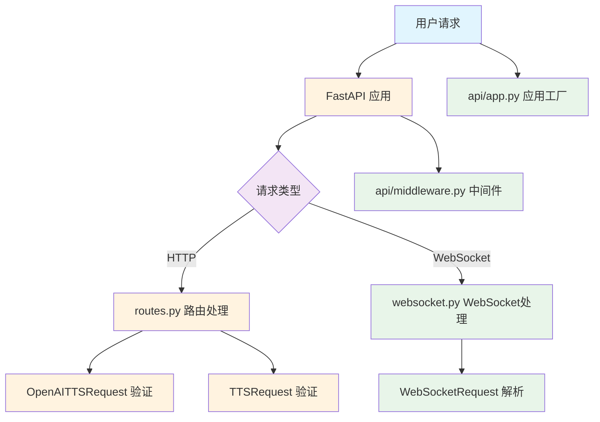
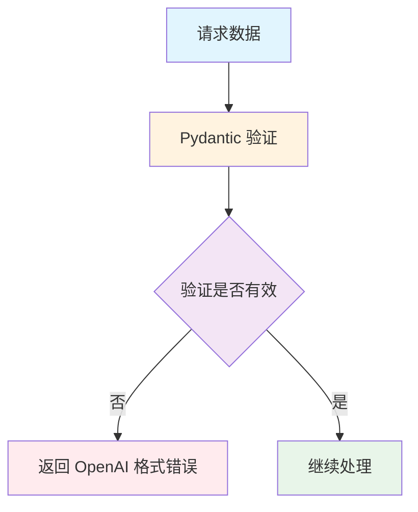
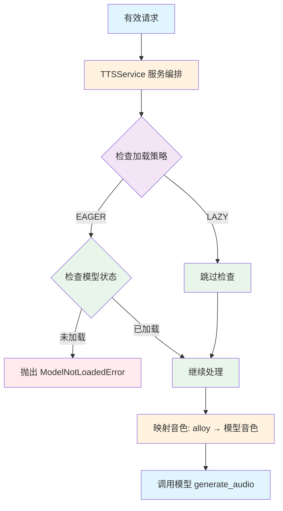
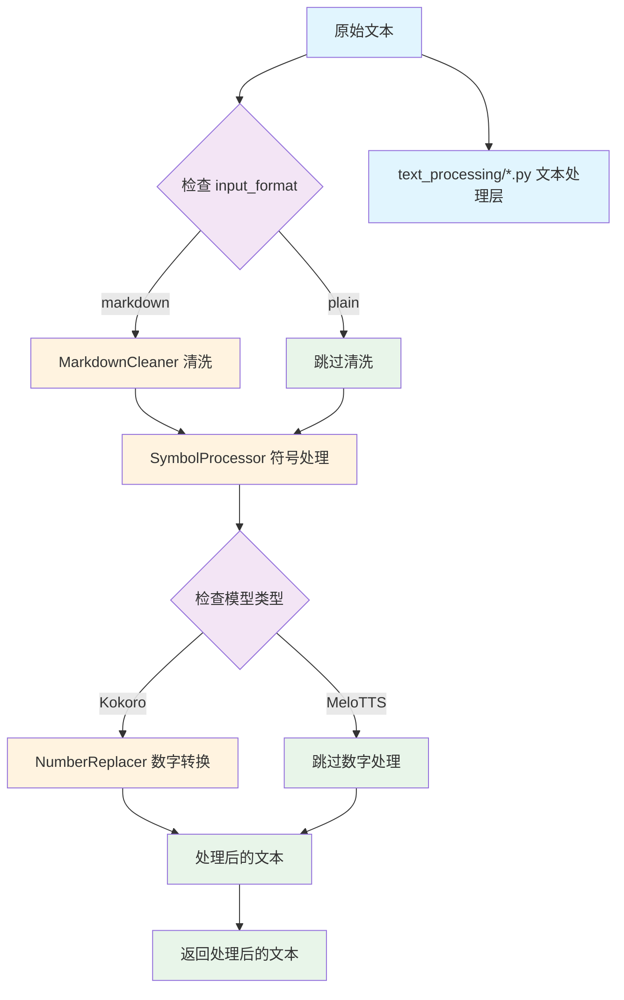
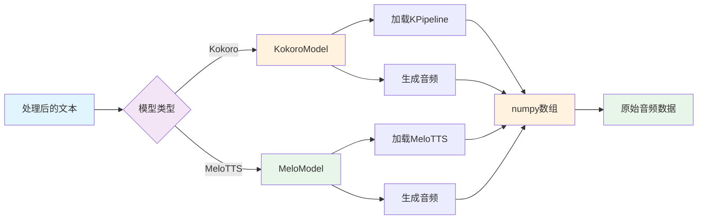
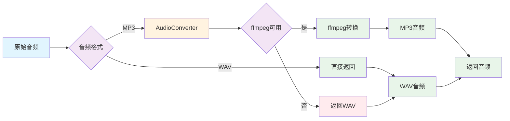
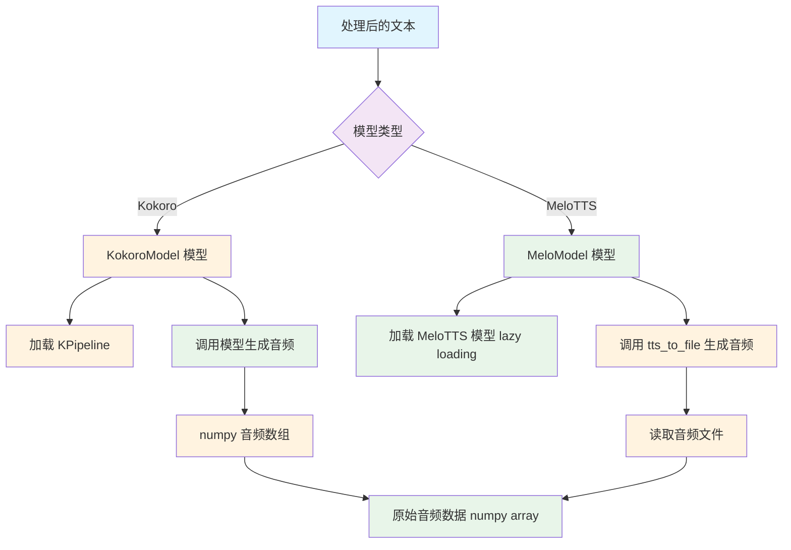
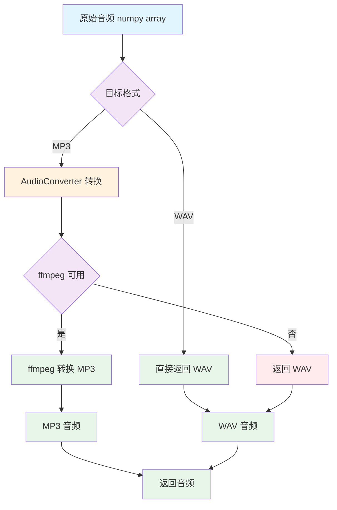
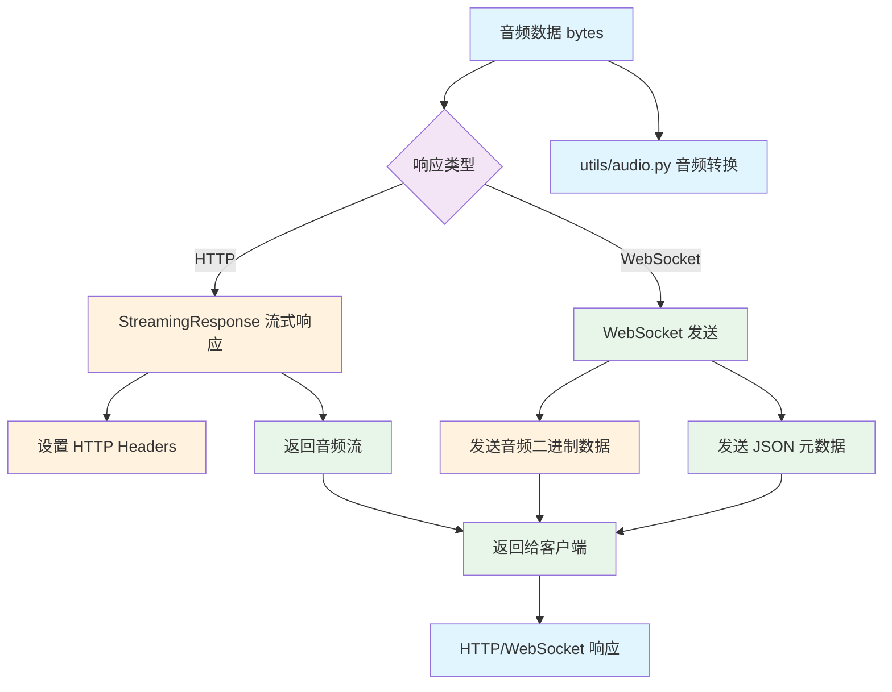

# TTS Service 架构设计文档

本文档详细说明 TTS Service 的整体架构设计、模块划分以及数据处理流程。

## 📋 目录

- [整体架构](#整体架构)
- [目录结构](#目录结构)
- [模块设计](#模块设计)
- [TTS 处理流程](#tts-处理流程)
- [数据流图](#数据流图)
- [模块交互](#模块交互)
- [设计原则](#设计原则)

---

## 整体架构

### 系统架构图

```
┌─────────────────────────────────────────────────────────────┐
│                         客户端层                              │
│  HTTP Client / WebSocket Client / API Tester                │
└─────────────────────────────────────────────────────────────┘
                              │
                              ▼
┌─────────────────────────────────────────────────────────────┐
│                         API 层                                │
│  ┌─────────────────────────────────────────────────────┐   │
│  │ FastAPI Application                                    │   │
│  │ 📄 api/app.py                                         │   │
│  └─────────────────────────────────────────────────────┘   │
│                                                              │
│  ┌──────────┐  ┌──────────┐  ┌──────────────────┐         │
│  │ Routes   │  │WebSocket │  │   Middleware     │         │
│  │📄routes  │  │📄websocket│  │📄middleware      │         │
│  └──────────┘  └──────────┘  └──────────────────┘         │
└─────────────────────────────────────────────────────────────┘
                              │
                              ▼
┌─────────────────────────────────────────────────────────────┐
│                        服务层                                │
│  ┌─────────────────────────────────────────────────────┐   │
│  │ TTSService (服务编排)                                  │   │
│  │ 📄 services/tts_service.py                             │   │
│  └─────────────────────────────────────────────────────┘   │
│                                                              │
│  ┌─────────────────────────────────────────────────────┐   │
│  │ QueueManager (请求队列)                                │   │
│  │ 📄 services/queue_manager.py                          │   │
│  └─────────────────────────────────────────────────────┘   │
└─────────────────────────────────────────────────────────────┘
                              │
                              ▼
┌─────────────────────────────────────────────────────────────┐
│                        模型层                                │
│  ┌──────────────────────┐  ┌──────────────────────┐      │
│  │   KokoroModel        │  │    MeloModel         │      │
│  │ 📄models/kokoro/     │  │ 📄models/melo/       │      │
│  │     model.py         │  │     model.py         │      │
│  └──────────────────────┘  └──────────────────────┘      │
│         │                           │                      │
│  ┌──────────────────────────────────────────────┐         │
│  │         BaseModel (抽象基类)                │         │
│  │         📄 models/base.py                   │         │
│  └──────────────────────────────────────────────┘         │
└─────────────────────────────────────────────────────────────┘
                              │
                              ▼
┌─────────────────────────────────────────────────────────────┐
│                        文本处理层                            │
│  ┌──────────┐  ┌──────────┐  ┌──────────┐  ┌──────────┐  │
│  │Markdown  │  │Sentence  │  │ Symbol   │  │ Number   │  │
│  │Cleaner   │  │Splitter  │  │Processor │  │Processor │  │
│  │📄markdown│  │📄sentence│  │📄symbol  │  │📄number  │  │
│  │_cleaner  │  │_splitter │  │_processor│  │_processor│  │
│  └──────────┘  └──────────┘  └──────────┘  └──────────┘  │
└─────────────────────────────────────────────────────────────┘
                              │
                              ▼
┌─────────────────────────────────────────────────────────────┐
│                        工具层                                │
│  ┌──────────┐  ┌──────────┐  ┌──────────┐                 │
│  │  Audio   │  │  Device  │  │  Logger  │                 │
│  │Converter │  │Detector  │  │Config    │                 │
│  │📄audio   │  │📄device  │  │📄logger  │                 │
│  └──────────┘  └──────────┘  └──────────┘                 │
└─────────────────────────────────────────────────────────────┘
                              │
                              ▼
┌─────────────────────────────────────────────────────────────┐
│                        配置层                                │
│  ┌──────────────────┐  ┌──────────────────┐                │
│  │   Settings       │  │  ModelConfig     │                │
│  │📄config/settings │  │📄config/model_  │                │
│  │  .py             │  │ config.py        │                │
│  └──────────────────┘  └──────────────────┘                │
└─────────────────────────────────────────────────────────────┘
```

---

## 目录结构

### 完整目录结构图

```
TTS_Service/
│
├── main.py                          # 🚀 应用入口
├── .env                             # ⚙️ 环境配置
├── requirements*.txt                # 📦 依赖管理
├── README.md                        # 📖 项目文档
│
├── api/                             # 🔌 API 层（模型无关）
│   ├── __init__.py
│   ├── app.py                      # FastAPI 应用工厂
│   ├── routes.py                   # HTTP 路由处理器
│   ├── websocket.py                # WebSocket 处理器
│   └── middleware.py               # CORS 和错误处理
│
├── services/                        # 💼 服务层
│   ├── __init__.py
│   ├── tts_service.py              # TTS 服务编排
│   └── queue_manager.py            # 请求队列管理
│
├── models/                          # 🤖 模型层（可插拔）
│   ├── __init__.py
│   ├── base.py                     # 模型抽象基类
│   ├── kokoro/                     # Kokoro 实现
│   │   ├── __init__.py
│   │   ├── model.py               # KokoroModel 实现
│   │   ├── config.py              # 配置常量
│   │   ├── voice_mapping.json    # 音色映射
│   │   ├── models_zh/             # 模型文件（符号链接）
│   │   └── voices/                # 音色文件（符号链接）
│   └── melo/                      # MeloTTS 实现
│       ├── __init__.py
│       ├── model.py               # MeloModel 实现
│       ├── config.py              # 配置常量
│       └── voice_mapping.json    # Speaker 映射
│
├── text_processing/                 # 📝 文本处理层
│   ├── __init__.py
│   ├── markdown_cleaner.py        # Markdown 清洗
│   ├── sentence_splitter.py       # 句子分割
│   ├── symbol_processor.py        # 符号处理
│   └── number_processor.py        # 数字处理
│
├── utils/                           # 🔧 工具层
│   ├── __init__.py
│   ├── audio.py                    # 音频格式转换
│   ├── device.py                   # 设备检测
│   └── logger.py                   # 日志配置
│
├── config/                          # ⚙️ 配置层
│   ├── __init__.py
│   ├── settings.py                 # 全局设置
│   └── model_config.py             # 模型配置
│
└── core/                            # 🎯 核心接口
    ├── __init__.py
    ├── tts_interface.py           # TTS 模型抽象接口
    ├── text_processor_interface.py # 文本处理器接口
    ├── models.py                   # Pydantic 数据模型
    └── exceptions.py               # 自定义异常
```

---

## 模块设计

### 核心模块说明

#### 1. API 层 (`api/`)

**职责**：处理 HTTP/WebSocket 请求，返回响应

**关键文件**：
- `app.py` - FastAPI 应用工厂，负责组装所有组件
- `routes.py` - HTTP 端点实现（/v1/audio/speech, /tts, /tts_post, /v1/audio/voices, /health）
- `websocket.py` - WebSocket 端点实现（/ws/tts）
- `middleware.py` - CORS 和异常处理中间件

**特点**：
- ✅ 模型无关 - 不直接依赖具体模型
- ✅ 依赖注入 - 通过 TTSService 调用模型
- ✅ 统一响应格式 - OpenAI API 兼容

#### 2. 服务层 (`services/`)

**职责**：业务逻辑编排，连接 API 层和模型层

**关键文件**：
- `tts_service.py` - TTS 服务编排
  - 封装 TTSModelInterface 实例
  - 提供统一的音频生成接口
  - 处理音色映射和验证
- `queue_manager.py` - 请求队列管理
  - 管理并发 TTS 请求
  - 防止资源冲突

**特点**：
- ✅ 解耦 - API 层不直接访问模型
- ✅ 可测试 - 可以 Mock TTSService
- ✅ 状态管理 - 追踪模型加载状态

#### 3. 模型层 (`models/`)

**职责**：实现 TTS 模型接口，提供音频生成能力

**关键文件**：
- `base.py` - 模型抽象基类
  - 实现 TTSModelInterface 接口
  - 提供通用功能（is_model_loaded, set_model_loaded）
- `kokoro/model.py` - Kokoro 模型实现
  - 封装 kokoro-github 库
  - 实现 eager loading
  - 支持音色文件映射
- `melo/model.py` - MeloTTS 模型实现
  - 封装 melo.api.TTS
  - 实现 lazy loading
  - 支持双模型架构

**特点**：
- ✅ 可插拔 - 实现统一接口即可添加新模型
- ✅ 独立 - 每个模型在独立目录
- ✅ 配置化 - 通过 JSON 文件配置音色

#### 4. 文本处理层 (`text_processing/`)

**职责**：预处理输入文本，提高 TTS 质量

**关键文件**：
- `markdown_cleaner.py` - 清洗 Markdown 格式
- `sentence_splitter.py` - 智能句子分割
- `symbol_processor.py` - 数学符号、货币符号处理
- `number_processor.py` - 数字转单词（Kokoro 专用）

**特点**：
- ✅ 共享 - 所有模型可复用
- ✅ 可选 - 根据模型选择使用
- ✅ 智能 - 自动检测语言

#### 5. 工具层 (`utils/`)

**职责**：提供通用工具函数

**关键文件**：
- `audio.py` - 音频格式转换（WAV ↔ MP3）
- `device.py` - 设备检测（CUDA/CPU/MPS）
- `logger.py` - 日志配置

**特点**：
- ✅ 独立 - 无业务逻辑
- ✅ 可复用 - 跨项目使用
- ✅ 跨平台 - 支持 Windows/Linux/macOS

#### 6. 配置层 (`config/`)

**职责**：管理配置，支持环境变量

**关键文件**：
- `settings.py` - 全局设置（Pydantic Settings）
- `model_config.py` - 模型配置加载

**特点**：
- ✅ 类型安全 - Pydantic 验证
- ✅ 环境变量 - 支持 .env 文件
- ✅ 分层管理 - 全局 + 模型特定

---

## TTS 处理流程

### 完整 TTS 流程图

```
用户请求 → API接收 → 请求验证 → 服务编排 → 模型生成 → 文本处理 → 音频生成 → 格式转换 → 响应返回
```

### 详细流程说明

#### 阶段 1: 请求接收（API 层）



**相关文件**：
- `api/app.py` - FastAPI 应用
- `api/routes.py` - HTTP 路由
- `api/websocket.py` - WebSocket 处理
- `core/models.py` - 请求数据模型

#### 阶段 2: 请求验证（API 层）



**验证内容**：
- 文本长度（1-4096 字符）
- 语速范围（0.25-4.0）
- 音色有效性
- 音频格式（mp3/wav）

**相关文件**：
- `core/models.py` - OpenAITTSRequest, TTSRequest
- `api/middleware.py` - 异常处理

#### 阶段 3: 服务编排（服务层）



**处理步骤**：
1. 检查模型加载策略（EAGER/LAZY）
2. 对于 EAGER 策略，检查模型是否已加载
3. 映射 OpenAI 音色到模型音色
4. 调用模型生成音频

**相关文件**：
- `services/tts_service.py` - TTSService
- `models/kokoro/model.py` - KokoroModel
- `models/melo/model.py` - MeloModel
- `models/*/voice_mapping.json` - 音色映射

#### 阶段 4: 文本处理（文本处理层）



**处理步骤**（Kokoro）：
1. 清洗 Markdown 格式（如需要）
2. 处理特殊符号（数学、货币、单位）
3. 数字转换（电话、IP、货币、数字）

**处理步骤**（MeloTTS）：
1. 清洗 Markdown 格式（如需要）
2. 处理特殊符号
3. 不进行数字转换（MeloTTS 原生支持）

**相关文件**：
- `text_processing/markdown_cleaner.py` - MarkdownCleaner
- `text_processing/symbol_processor.py` - SpecialSymbolProcessor
- `text_processing/number_processor.py` - NumberReplacer
- `text_processing/sentence_splitter.py` - SentenceSplitter

#### 阶段 5: 音频生成（模型层）



**Kokoro 生成流程**：
1. 根据语言代码获取 Pipeline
2. 逐句生成音频
3. 合并音频片段

**MeloTTS 生成流程**：
1. 检测文本语言
2. 加载对应模型（ZH/EN）
3. 生成音频到临时文件
4. 读取音频数据

**相关文件**：
- `models/kokoro/model.py` - KokoroModel.generate_audio()
- `models/melo/model.py` - MeloModel.generate_audio()

#### 阶段 6: 音频转换（工具层）



**转换流程**：
1. numpy 数组 → WAV 字节
2. WAV → MP3（如需要）
3. Fallback 机制：soundfile → ffmpeg → WAV

**相关文件**：
- `utils/audio.py` - AudioConverter
- `config/settings.py` - 音频格式配置

#### 阶段 5: 音频生成（模型层）



#### 阶段 6: 音频转换（工具层）



#### 阶段 7: 响应返回（API 层）



**响应格式**：
- HTTP: StreamingResponse + media_type
- WebSocket: 二进制音频 + JSON 元数据

**相关文件**：
- `api/routes.py` - StreamingResponse
- `api/websocket.py` - WebSocket 消息

---

## 数据流图

### 请求数据流

```
用户请求 JSON
    ↓
Pydantic 验证 (core/models.py)
    ↓
FastAPI 路由 (api/routes.py)
    ↓
TTSService 调用 (services/tts_service.py)
    ↓
模型接口调用 (models/*/model.py)
    ↓
文本处理 (text_processing/*.py)
    ↓
音频生成 (kokoro/melo 库)
    ↓
音频转换 (utils/audio.py)
    ↓
响应返回 (api/routes.py)
```

### WebSocket 数据流

```
WebSocket 连接 (api/websocket.py)
    ↓
接收 JSON 请求
    ↓
解析请求参数
    ↓
TTSService.generate_audio_stream()
    ↓
模型流式生成 (models/*/model.py)
    ↓
逐句生成音频
    ↓
发送元数据 JSON {"type": "sentence_start"}
    ↓
发送音频二进制数据
    ↓
发送元数据 JSON {"type": "sentence_end"}
    ↓
重复直到完成
    ↓
发送完成消息 {"type": "done"}
```

---

## 模块交互

### 核心类交互图

```
┌──────────────────┐
│   main.py        │
│  应用入口        │
└────────┬─────────┘
         │
         ▼
┌──────────────────┐
│ api/app.py       │
│ create_app()     │
└────────┬─────────┘
         │
    ┌────┴────┐
    ▼         ▼
┌────────┐  ┌────────────┐
│Settings│  │ get_model_  │
│        │  │  class()    │
└────────┘  └──────┬──────┘
                   │
         ┌─────────┴─────────┐
         ▼                   ▼
┌──────────────┐   ┌──────────────┐
│ KokoroModel  │   │  MeloModel   │
│              │   │              │
│ (kokoro/)    │   │ (melo/)     │
└──────────────┘   └──────────────┘
         │                   │
         └─────────┬─────────┘
                   ▼
         ┌──────────────────┐
         │   TTSService      │
         │ (services/tts_    │
         │   service.py)     │
         └─────────┬─────────┘
                   │
         ┌─────────┴─────────┐
         ▼                   ▼
┌──────────────┐   ┌──────────────┐
│   Routes     │   │  WebSocket  │
│ (api/routes) │   │(api/websock)│
└──────────────┘   └──────────────┘
```

### 调用链路

#### HTTP 请求调用链

```
1. main.py
   ↓
2. api/app.py::create_app()
   ↓
3. api/routes.py::create_speech()
   ↓
4. services/tts_service.py::generate_audio()
   ↓
5. models/kokoro/model.py::generate_audio() [或 melo]
   ↓
6. text_processing/*.py (文本处理)
   ↓
7. utils/audio.py (音频转换)
   ↓
8. api/routes.py::StreamingResponse (返回)
```

#### WebSocket 请求调用链

```
1. main.py
   ↓
2. api/app.py::create_app()
   ↓
3. api/websocket.py::websocket_tts()
   ↓
4. services/tts_service.py::generate_audio_stream()
   ↓
5. models/kokoro/model.py::generate_audio_stream() [或 melo]
   ↓
6. text_processing/*.py (分句处理)
   ↓
7. utils/audio.py (音频转换)
   ↓
8. api/websocket.py (发送数据)
```

---

## 设计原则

### 1. 模型独立性

**目标**：切换模型只需修改配置，不改代码

**实现**：
- 统一的 `TTSModelInterface` 接口
- API 层通过 `TTSService` 调用模型
- 模型通过 `get_model_class()` 动态加载

**示例**：
```python
# 切换模型只需修改 .env 文件
TTS_MODEL=kokoro  # 或 melo
```

### 2. 接口统一

**目标**：所有模型实现相同的接口

**实现**：
- `TTSModelInterface` 定义标准接口
- `BaseModel` 提供通用实现
- 模型类继承并实现抽象方法

**接口方法**：
```python
- get_model_name()           # 返回模型名称
- get_supported_voices()     # 返回支持的音色
- map_voice()                # 映射音色
- generate_audio()           # 生成完整音频
- generate_audio_stream()    # 生成流式音频
- get_loading_strategy()     # 返回加载策略
- initialize_model()         # 初始化模型
- is_model_loaded()          # 检查模型状态
- cleanup()                  # 清理资源
```

### 3. 代码复用

**目标**：共享通用组件，减少重复代码

**实现**：
- 文本处理模块共享
- 工具函数模块化
- 配置统一管理

**示例**：
```python
# 多个模型共享同一个文本处理器
from text_processing import MarkdownCleaner

cleaner = MarkdownCleaner()
text = cleaner.clean(markdown_text)
```

### 4. 易于扩展

**目标**：添加新模型只需实现接口

**步骤**：
1. 创建 `models/new_model/` 目录
2. 实现 `TTSModelInterface` 接口
3. 创建 `voice_mapping.json`
4. 在 `get_model_class()` 添加分支
5. 更新 `settings.py` 中的 `tts_model` 选项

**示例**：
```python
# models/new_model/model.py
class NewModel(BaseModel):
    def get_model_name(self) -> str:
        return "new_model"

    # 实现其他接口方法...
```

### 5. 职责分离

**目标**：每个模块有明确的职责

**分层架构**：
```
API 层        → 处理 HTTP/WebSocket 请求
服务层        → 业务逻辑编排
模型层        → 提供音频生成能力
文本处理层    → 预处理输入文本
工具层        → 提供通用工具函数
配置层        → 管理配置
```

### 6. 可测试性

**目标**：易于编写单元测试和集成测试

**实现**：
- 依赖注入 - TTSService 可注入 Mock 模型
- 接口抽象 - 可以 Mock TTSModelInterface
- 配置分离 - 测试时使用测试配置

**示例**：
```python
# 可以 Mock TTSService 进行 API 测试
def test_create_speech():
    mock_service = Mock(spec=TTSService)
    mock_service.generate_audio.return_value = (audio_bytes, "audio/mpeg")
    # 测试 API 逻辑
```

---

## 附录

### A. 关键技术栈

| 组件 | 技术 |
|------|------|
| Web 框架 | FastAPI |
| 异步支持 | asyncio, aiofiles |
| 数据验证 | Pydantic |
| 音频处理 | soundfile, numpy, scipy |
| 深度学习 | PyTorch |
| TTS 模型 | kokoro-github, melo-tts |

### B. 相关文档

- [Kokoro 部署文档](01_deployment_kokoro.md)
- [MeloTTS 部署文档](02_deployment_melo.md)
- [核心类设计](04_class_design_core.md)
- [模型类设计](05_class_design_models.md)
- [服务类设计](06_class_design_services.md)
- [API 类设计](07_class_design_api.md)

### C. 架构演进

**当前版本 (v1.0)**：
- ✅ 模型可插拔
- ✅ OpenAI API 兼容
- ✅ 流式音频支持
- ✅ 多种音频格式

**未来规划**：
- 🔄 增加更多 TTS 模型
- 🔄 支持音频缓存
- 🔄 分布式部署
- 🔄 性能监控和优化
