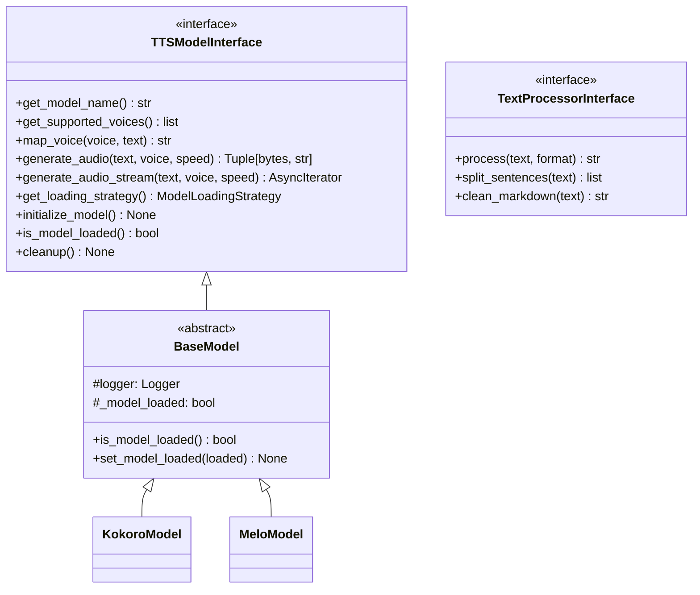
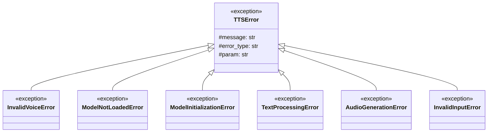
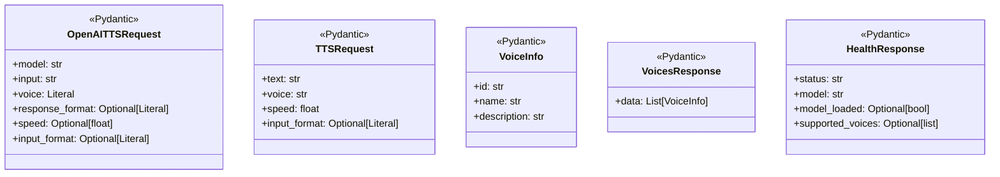

# 核心类设计文档

本文档详细说明核心模块的类设计和它们之间的关系。

## 📋 目录

- [概述](#概述)
- [TTSModelInterface 接口](#tttsmodelinterface-接口)
- [TextProcessorInterface 接口](#textprocessorinterface-接口)
- [BaseModel 抽象类](#basemodel-抽象类)
- [数据模型类](#数据模型类)
- [异常类](#异常类)
- [UML 类图](#uml-类图)
- [类关系说明](#类关系说明)

---

## 概述

核心模块定义了整个 TTS Service 的基础接口和抽象类，确保模型可插拔性和代码一致性。

### 核心模块结构

```
core/
├── __init__.py              # 模块导出
├── tts_interface.py         # TTS 模型接口
├── text_processor_interface.py  # 文本处理器接口
├── models.py                # 数据模型
└── exceptions.py            # 自定义异常
```

---

## TTSModelInterface 接口

### 类定义

```python
from abc import ABC, abstractmethod
from typing import AsyncIterator, Tuple

class TTSModelInterface(ABC):
    """TTS 模型抽象接口"""
```

### 接口方法详解

#### 1. get_model_name()
```python
@abstractmethod
def get_model_name(self) -> str:
    """返回模型标识符"""
```

**作用**: 返回模型的唯一标识符
**返回值**: 模型名称（如 "kokoro", "melo"）
**实现要求**: 返回字符串，用于日志、健康检查
**示例**:
```python
def get_model_name(self) -> str:
    return "kokoro"
```

#### 2. get_supported_voices()
```python
@abstractmethod
def get_supported_voices(self) -> list:
    """返回支持的音色列表"""
```

**作用**: 返回模型支持的所有音色
**返回值**: 音色列表（如 ["af_heart", "af_maple", ...]）
**实现要求**: 返回模型可用的音色标识符列表
**示例**:
```python
def get_supported_voices(self) -> list:
    return ["af_heart", "af_maple", "af_sarah"]
```

#### 3. map_voice()
```python
@abstractmethod
def map_voice(self, requested_voice: str, text: str) -> str:
    """将请求的音色映射到模型特定的音色"""
```

**作用**: 将用户请求的 OpenAI 风格音色映射到模型特定音色
**参数**:
- `requested_voice`: 用户请求的音色（如 "alloy"）
- `text`: 要合成的文本（用于语言检测和音色优化）

**返回值**: 映射后的模型特定音色标识符
**实现要求**:
- 查找音色映射配置
- 根据文本语言优化音色选择
- 返回模型可用的音色

**示例**:
```python
def map_voice(self, requested_voice: str, text: str) -> str:
    # "alloy" → "bf_vale" (Kokoro)
    # "alloy" → "BILINGUAL" (MeloTTS)
    return self.voice_mapping.get(requested_voice, requested_voice)
```

#### 4. generate_audio()
```python
@abstractmethod
async def generate_audio(
    self,
    text: str,
    voice: str,
    speed: float = 1.0,
    **kwargs
) -> Tuple[bytes, str]:
    """生成完整音频"""
```

**作用**: 生成完整的音频数据
**参数**:
- `text`: 输入文本
- `voice`: 已映射的模型音色
- `speed`: 语速（0.25-4.0）
- `**kwargs`: 模型特定参数

**返回值**: (audio_bytes, media_type) 元组
- `audio_bytes`: 音频字节数据
- `media_type`: 媒体类型（"audio/wav" 或 "audio/mpeg"）

**实现要求**:
- 处理文本（如需要）
- 调用模型生成音频
- 转换音频格式
- 返回标准格式的音频数据

**示例**:
```python
async def generate_audio(
    self,
    text: str,
    voice: str,
    speed: float = 1.0,
    **kwargs
) -> Tuple[bytes, str]:
    # 1. 处理文本
    processed_text = self._process_text(text)

    # 2. 生成音频
    audio = self.model.generate(processed_text, voice, speed)

    # 3. 转换格式
    audio_bytes, media_type = AudioConverter.convert(audio)

    return audio_bytes, media_type
```

#### 5. generate_audio_stream()
```python
@abstractmethod
async def generate_audio_stream(
    self,
    text: str,
    voice: str,
    speed: float = 1.0,
    **kwargs
) -> AsyncIterator[Tuple[bytes, dict]]:
    """生成流式音频"""
```

**作用**: 流式生成音频，用于 WebSocket
**参数**: 同 `generate_audio()`

**返回值**: 异步迭代器，产生 (audio_chunk, metadata) 元组
- `audio_chunk`: 音频数据块
- `metadata`: 元数据字典
  ```python
  {
      "type": "sentence_start|sentence_end|done",
      "index": int,
      "text": str,
      "voice": str,
      "total_sentences": int,
      "total_chunks": int,
      "total_bytes": int
  }
  ```

**实现要求**:
- 分句处理文本
- 逐句生成音频
- 产生元数据和音频块
- 让出控制权（await asyncio.sleep(0)）

**示例**:
```python
async def generate_audio_stream(...):
    sentences = self.split(text)

    for idx, sentence in enumerate(sentences):
        # 发送句子开始
        yield b'', {"type": "sentence_start", "index": idx, "text": sentence}

        # 生成音频
        audio = await self.generate(sentence, voice, speed)

        # 发送音频块
        yield audio, {"type": "audio_chunk", "index": idx}

        # 发送句子结束
        yield b'', {"type": "sentence_end", "index": idx}

    # 发送完成
    yield b'', {"type": "done", "total_sentences": len(sentences)}
```

#### 6. get_loading_strategy()
```python
@abstractmethod
def get_loading_strategy(self) -> ModelLoadingStrategy:
    """返回模型加载策略"""
```

**作用**: 返回模型的加载策略
**返回值**: `ModelLoadingStrategy.EAGER` 或 `ModelLoadingStrategy.LAZY`
- `EAGER`: 启动时加载（Kokoro）
- `LAZY`: 延迟加载（MeloTTS）

**实现要求**: 返回枚举值，用于应用启动时的模型初始化

**示例**:
```python
def get_loading_strategy(self) -> ModelLoadingStrategy:
    return ModelLoadingStrategy.EAGER
```

#### 7. initialize_model()
```python
@abstractmethod
def initialize_model(self) -> None:
    """初始化/加载模型"""
```

**作用**: 加载模型到内存
**实现要求**:
- 检查设备（CUDA/CPU/MPS）
- 加载模型文件
- 初始化模型组件
- 调用 `set_model_loaded(True)`

**示例**:
```python
def initialize_model(self) -> None:
    # 1. 检测设备
    self.device = get_device('auto')

    # 2. 加载模型
    self.model = load_model(self.config_path)

    # 3. 标记已加载
    self.set_model_loaded(True)
```

#### 8. is_model_loaded()
```python
@abstractmethod
def is_model_loaded(self) -> bool:
    """检查模型是否已加载"""
```

**作用**: 检查模型是否已加载到内存
**返回值**: `True` 已加载，`False` 未加载

**实现要求**: 返回内部状态标志

**示例**:
```python
def is_model_loaded(self) -> bool:
    return self._model_loaded
```

#### 9. cleanup()
```python
@abstractmethod
def cleanup(self) -> None:
    """清理模型资源"""
```

**作用**: 释放模型占用的资源
**实现要求**:
- 删除模型引用
- 清理 GPU 缓存
- 调用 `set_model_loaded(False)`

**示例**:
```python
def cleanup(self) -> None:
    del self.model
    clear_device_cache(self.device)
    self.set_model_loaded(False)
```

---

## TextProcessorInterface 接口

### 类定义

```python
from abc import ABC, abstractmethod
from typing import List

class TextProcessorInterface(ABC):
    """文本处理器抽象接口"""
```

### 接口方法详解

#### 1. process()
```python
@abstractmethod
def process(self, text: str, input_format: str = "plain") -> str:
    """处理输入文本"""
```

**作用**: 统一的文本处理接口
**参数**:
- `text`: 原始文本
- `input_format`: 输入格式（"plain" 或 "markdown"）

**返回值**: 处理后的文本

**实现要求**:
- 清洗 Markdown（如需要）
- 处理特殊符号
- 数字处理（可选）

#### 2. split_sentences()
```python
@abstractmethod
def split_sentences(self, text: str) -> List[str]:
    """将文本分割成句子"""
```

**作用**: 智能分句，用于流式生成
**返回值**: 句子列表

**实现要求**:
- 按标点符号分割
- 处理缩写和小数点
- 控制句子长度

#### 3. clean_markdown()
```python
@abstractmethod
def clean_markdown(self, text: str) -> str:
    """清洗 Markdown 格式"""
```

**作用**: 移除 Markdown 格式符号
**返回值**: 纯文本

---

## BaseModel 抽象类

### 类定义

```python
class BaseModel(TTSModelInterface, ABC):
    """模型基类 - 实现 TTS 模型接口"""
```

### 继承关系

```
BaseModel
├── 继承: TTSModelInterface
├── 继承: ABC (Abstract Base Class)
└── 被继承: KokoroModel, MeloModel
```

### 类成员

#### 属性
- `logger: logging.Logger` - 日志记录器
- `_model_loaded: bool` - 模型加载状态

#### 实现的方法

**is_model_loaded()**
```python
def is_model_loaded(self) -> bool:
    """检查模型是否已加载"""
    return self._model_loaded
```
- 提供默认实现
- 返回内部状态

**set_model_loaded()**
```python
def set_model_loaded(self, loaded: bool) -> None:
    """设置模型加载状态"""
    self._model_loaded = loaded
```
- 供子类更新状态
- 确保状态一致性

#### 抽象方法（子类必须实现）

```python
@abstractmethod
def get_model_name(self) -> str:
    """返回模型名称"""
    pass

@abstractmethod
def get_supported_voices(self) -> List[str]:
    """返回支持的音色列表"""
    pass

@abstractmethod
def map_voice(self, requested_voice: str, text: str) -> str:
    """映射音色"""
    pass

@abstractmethod
def initialize_model(self) -> None:
    """初始化模型"""
    pass

@abstractmethod
async def generate_audio(...) -> Tuple[bytes, str]:
    """生成音频"""
    pass

@abstractmethod
async def generate_audio_stream(...) -> AsyncIterator[Tuple[bytes, dict]]:
    """生成流式音频"""
    pass

@abstractmethod
def get_loading_strategy(self) -> ModelLoadingStrategy:
    """返回模型加载策略"""
    pass

@abstractmethod
def cleanup(self) -> None:
    """清理模型资源"""
    pass
```

---

## 数据模型类

### Pydantic 模型

#### OpenAITTSRequest
```python
class OpenAITTSRequest(BaseModel):
    model: str = "tts-1"
    input: str = Field(..., min_length=1, max_length=4096)
    voice: Literal["alloy", "echo", "fable", "onyx", "nova", "shimmer"]
    response_format: Optional[Literal["mp3", "wav"]] = "mp3"
    speed: Optional[float] = Field(default=1.0, ge=0.25, le=4.0)
    input_format: Optional[Literal["plain", "markdown"]] = "plain"
```

**作用**: OpenAI 兼容的请求验证
**验证规则**:
- 文本长度: 1-4096 字符
- 语速范围: 0.25-4.0
- 音色: 6 种预定义音色

#### TTSRequest
```python
class TTSRequest(BaseModel):
    text: str
    voice: str = "alloy"
    speed: float = Field(default=1.0, ge=0.25, le=4.0)
    input_format: Optional[Literal["plain", "markdown"]] = "plain"
```

**作用**: 通用 TTS 请求验证

#### VoiceInfo / VoicesResponse / HealthResponse

**作用**: 标准化 API 响应格式

---

## 异常类

### 异常层次结构

```
TTSError (Exception)
├── InvalidVoiceError
├── ModelNotLoadedError
├── ModelInitializationError
├── TextProcessingError
├── AudioGenerationError
└── InvalidInputError
```

### TTSError 基类

```python
class TTSError(Exception):
    def __init__(self, message: str, error_type: str, param: Optional[str] = None):
        self.message = message
        self.error_type = error_type
        self.param = param
```

**作用**: 所有 TTS 异常的基类
**成员**:
- `message`: 错误消息
- `error_type`: 错误类型
- `param`: 相关参数（可选）

### 具体异常类

#### InvalidVoiceError
```python
class InvalidVoiceError(TTSError):
    def __init__(self, voice: str, supported_voices: list):
        message = f"Invalid voice '{voice}'. Supported voices: {', '.join(supported_voices)}"
        super().__init__(message, "invalid_request_error", "voice")
```
**使用场景**: 用户请求了不支持的音色

#### ModelNotLoadedError
```python
class ModelNotLoadedError(TTSError):
    def __init__(self, model_name: str):
        message = f"Model '{model_name}' is not loaded"
        super().__init__(message, "model_not_loaded")
```
**使用场景**: 模型未加载时尝试生成音频

#### AudioGenerationError
```python
class AudioGenerationError(TTSError):
    def __init__(self, reason: str):
        message = f"Audio generation failed: {reason}"
        super().__init__(message, "audio_generation_error")
```
**使用场景**: 音频生成失败

### openai_error_response()

```python
def openai_error_response(error: TTSError) -> Dict[str, Any]:
    result = {
        "error": {
            "message": error.message,
            "type": error.error_type,
            "code": error.code
        }
    }
    if error.param:
        result["error"]["param"] = error.param
    return result
```

**作用**: 生成 OpenAI 格式的错误响应
**返回格式**:
```json
{
  "error": {
    "message": "错误消息",
    "type": "错误类型",
    "code": "错误代码",
    "param": "相关参数"
  }
}
```

---

## UML 类图

### 核心类关系图



### 异常类层次图



### 数据模型类图



---

## 类关系说明

### 1. 接口与实现关系

**TTSModelInterface** 是核心接口，定义了所有 TTS 模型必须实现的方法。

**实现关系**:
```
TTSModelInterface (接口)
    ↑
    | 继承/实现
    |
BaseModel (抽象类)
    ↑
    | 继承
    |
├───────────┬───────────┐
│           │           │
KokoroModel MeloModel
```

### 2. 依赖关系

**BaseModel 依赖**:
- `logging.Logger` - 日志记录
- `core.tts_interface.TTSModelInterface` - 接口定义
- `core.tts_interface.ModelLoadingStrategy` - 加载策略枚举

**KokoroModel 依赖**:
- `BaseModel` - 基类
- `kokoro.pipeline.KPipeline` - Kokoro Pipeline
- `kokoro.model.KModel` - Kokoro 模型
- `text_processing.*` - 文本处理模块
- `utils.audio` - 音频转换工具
- `config.settings` - 配置管理

**MeloModel 依赖**:
- `BaseModel` - 基类
- `melo.api.TTS` - MeloTTS API
- `text_processing.*` - 文本处理模块
- `utils.audio` - 音频转换工具
- `config.settings` - 配置管理

### 3. 组合关系

**TTSService 组合模型**:
```python
class TTSService:
    def __init__(self, model: TTSModelInterface):
        self.model = model  # 组合关系
```

**应用组装模型**:
```python
# api/app.py
ModelClass = get_model_class(settings.tts_model)
model = ModelClass()
tts_service = TTSService(model)
```

### 4. 使用关系

**API 层使用 TTSService**:
```python
# api/routes.py
@router.post("/v1/audio/speech")
async def create_speech(request: OpenAITTSRequest):
    audio, media_type = await tts_service.generate_audio(...)
    return StreamingResponse(...)
```

---

## 设计模式应用

### 1. 策略模式 (Strategy Pattern)

**TTSModelInterface** 定义了 TTS 生成的策略，不同模型是不同的策略实现。

```python
# 策略接口
TTSModelInterface

# 具体策略
KokoroModel
MeloModel

# 上下文
TTSService
```

### 2. 工厂模式 (Factory Pattern)

**get_model_class()** 函数充当工厂，根据配置创建模型实例。

```python
def get_model_class(model_type: str):
    if model_type == "kokoro":
        from .kokoro import KokoroModel
        return KokoroModel
    elif model_type == "melo":
        from .melo import MeloModel
        return MeloModel
```

### 3. 模板方法模式 (Template Method Pattern)

**BaseModel** 定义了算法骨架，子类实现具体步骤。

```python
# BaseModel 定义骨架
class BaseModel:
    def generate_audio(...):
        # 模板方法
        text = self._process_text(text)  # 调用子类实现
        audio = self._generate(...)      # 调用子类实现
        return self._convert(audio)       # 调用通用方法
```

### 4. 适配器模式 (Adapter Pattern)

**TTSService** 作为适配器，将不同的模型接口统一为标准的 API 接口。

```python
class TTSService:
    def generate_audio(...):
        # 适配不同的模型实现
        return await self.model.generate_audio(...)
```

---

## 扩展示例

### 添加新模型

假设要添加一个新的 TTS 模型 "NewModel"：

#### 步骤 1: 实现接口

```python
# models/new_model/model.py
from models.base import BaseModel

class NewModel(BaseModel):
    def get_model_name(self) -> str:
        return "new_model"

    def get_supported_voices(self) -> list:
        return ["voice1", "voice2"]

    # 实现其他接口方法...
```

#### 步骤 2: 更新工厂函数

```python
# models/__init__.py
def get_model_class(model_type: str):
    if model_type == "kokoro":
        from .kokoro import KokoroModel
        return KokoroModel
    elif model_type == "melo":
        from .melo import MeloModel
        return MeloModel
    elif model_type == "new_model":
        from .new_model import NewModel
        return NewModel
```

#### 步骤 3: 更新配置

```python
# config/settings.py
tts_model: Literal["kokoro", "melo", "new_model"] = "kokoro"
```

---

## 相关文档

- [架构设计文档](03_architecture_design.md)
- [模型类设计](05_class_design_models.md)
- [服务类设计](06_class_design_services.md)
- [API 类设计](07_class_design_api.md)
