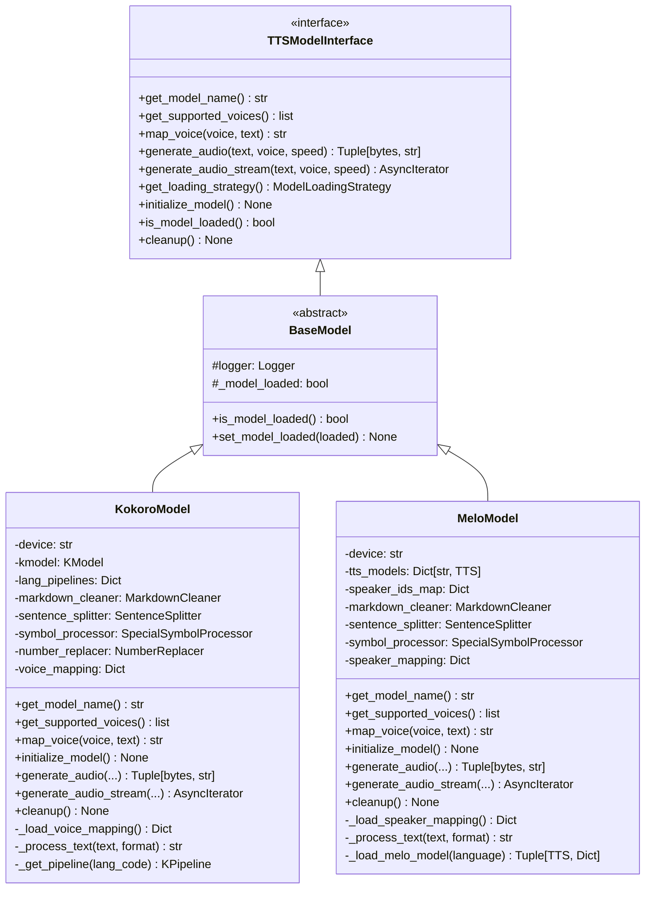
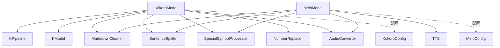

# 模型类设计文档

本文档详细说明 Kokoro 和 MeloTTS 模型的类设计和实现细节。

## 📋 目录

- [KokoroModel 类](#kokoromodel-类)
- [MeloModel 类](#melomodel-类)
- [模型对比](#模型对比)
- [UML 类图](#uml-类图)
- [扩展示例](#扩展示例)

---

## KokoroModel 类

### 类定义

**文件**: `models/kokoro/model.py`

```python
class KokoroModel(BaseModel):
    """Kokoro TTS 模型实现"""
```

### 核心职责

- 封装 `kokoro-github` 库
- 实现 Eager Loading 策略（启动时加载模型）
- 支持多语言 Pipeline（ZH/EN）
- 支持音色文件映射
- 处理数字转英文（Kokoro 专用）
- 流式音频生成

### 类属性

```python
# 设备和模型
device: str                    # 计算设备（cuda/cpu/mps）
kmodel: KModel                # Kokoro 模型实例
lang_pipelines: Dict[str, KPipeline]  # 语言 Pipeline 映射
en_pipeline: KPipeline        # 英文 Pipeline
en_callable: Callable         # 英文模型可调用对象

# 文本处理器
markdown_cleaner: MarkdownCleaner
sentence_splitter: SentenceSplitter
symbol_processor: SpecialSymbolProcessor
number_replacer: NumberReplacer

# 音色映射
voice_mapping: Dict[str, str]  # OpenAI 音色 → Kokoro 音色映射
```

### 关键方法详解

#### 1. get_model_name()

```python
def get_model_name(self) -> str:
    """返回模型标识符"""
    return "kokoro"
```

**作用**: 返回模型唯一标识符，用于日志和健康检查。

#### 2. get_supported_voices()

```python
def get_supported_voices(self) -> list:
    """返回支持的音色列表"""
    return SUPPORTED_VOICES
```

**返回值**: `["af_heart", "af_maple", "af_nicole", "af_sarah", "af_sol", "am_adam", "am_michael", "bf_vale"]`

#### 3. map_voice()

```python
def map_voice(self, requested_voice: str, text: str) -> str:
    """
    将请求的音色映射到 Kokoro 特定的音色

    Args:
        requested_voice: 用户请求的音色（如 "alloy"）
        text: 要合成的文本（用于语言检测和音色优化）

    Returns:
        Kokoro 特定的音色标识符
    """
    # 从映射表中获取
    mapped_voice = self.voice_mapping.get(requested_voice, requested_voice)

    # 根据文本语言优化音色选择
    optimal_voice = get_optimal_voice(mapped_voice, text)

    return optimal_voice
```

**音色映射示例**:
```python
{
    "alloy": "bf_vale",      # 双语音色
    "echo": "am_adam",       # 男声
    "fable": "af_sol",       # 女声
    "onyx": "am_michael",    # 男声
    "nova": "af_sarah",      # 女声
    "shimmer": "af_maple"    # 双语女声
}
```

#### 4. get_loading_strategy()

```python
def get_loading_strategy(self) -> ModelLoadingStrategy:
    """返回模型加载策略"""
    return ModelLoadingStrategy.EAGER
```

**说明**: Kokoro 使用 Eager Loading，在应用启动时立即加载模型。

#### 5. initialize_model()

```python
def initialize_model(self) -> None:
    """初始化 Kokoro 模型"""
    # 1. 检测设备
    self.device = get_device(settings.kokoro_device)

    # 2. 加载配置
    config_path = settings.kokoro_config_path
    model_path = settings.kokoro_model_path

    # 3. 加载 KModel
    self.kmodel = KModel(config_path, model_path, device=self.device)

    # 4. 初始化 Pipeline
    self._initialize_pipelines()

    # 5. 标记已加载
    self.set_model_loaded(True)

    self.logger.info(f"Kokoro model initialized on {self.device}")
```

#### 6. _process_text()

```python
def _process_text(self, text: str, input_format: str) -> str:
    """处理输入文本"""
    processed_text = text

    # 1. 清洗 Markdown
    if input_format == "markdown":
        processed_text = self.markdown_cleaner.clean(processed_text)

    # 2. 处理特殊符号
    processed_text = self.symbol_processor.process(processed_text)

    # 3. 数字转换（Kokoro 专用）
    processed_text = self.number_replacer.replace(processed_text)

    return processed_text
```

**处理流程**:
```
原始文本 → Markdown清洗 → 符号处理 → 数字转换 → 处理后文本
```

#### 7. generate_audio()

```python
async def generate_audio(
    self,
    text: str,
    voice: str,
    speed: float = 1.0,
    input_format: str = "plain",
    target_format: str = "mp3",
    **kwargs
) -> Tuple[bytes, str]:
    """生成完整音频"""

    # 1. 处理文本
    processed_text = self._process_text(text, input_format)

    # 2. 获取语言代码
    lang_code = get_lang_code(voice)

    # 3. 获取 Pipeline
    pipeline = self._get_pipeline(lang_code)

    # 4. 生成音频
    audio_array, sample_rate = self._generate_audio_array(
        processed_text, voice, speed, pipeline
    )

    # 5. 转换格式
    audio_bytes, media_type = AudioConverter.convert_to_format(
        audio_array, sample_rate, target_format
    )

    return audio_bytes, media_type
```

**音频生成流程**:
```
文本处理 → 获取Pipeline → 生成音频数组 → 格式转换 → 返回字节
```

#### 8. generate_audio_stream()

```python
async def generate_audio_stream(
    self,
    text: str,
    voice: str,
    speed: float = 1.0,
    input_format: str = "plain",
    **kwargs
) -> AsyncIterator[Tuple[bytes, dict]]:
    """流式生成音频"""

    # 1. 处理文本
    processed_text = self._process_text(text, input_format)

    # 2. 分句
    sentences = self.sentence_splitter.split(processed_text)
    total_sentences = len(sentences)

    # 3. 逐句生成
    for idx, sentence in enumerate(sentences):
        # 发送句子开始元数据
        yield b'', {
            "type": "sentence_start",
            "index": idx,
            "text": sentence,
            "voice": voice,
            "total_sentences": total_sentences
        }

        # 生成音频
        audio_bytes, _ = await self.generate_audio(
            text=sentence,
            voice=voice,
            speed=speed,
            target_format="wav"
        )

        # 发送音频数据
        yield audio_bytes, {"type": "audio_chunk", "index": idx}

        # 发送句子结束元数据
        yield b'', {"type": "sentence_end", "index": idx}

        # 让出控制权
        await asyncio.sleep(0)

    # 4. 发送完成信号
    yield b'', {"type": "done", "total_sentences": total_sentences}
```

#### 9. cleanup()

```python
def cleanup(self) -> None:
    """清理模型资源"""
    # 删除模型引用
    self.kmodel = None
    self.lang_pipelines.clear()
    self.en_pipeline = None

    # 清理设备缓存
    if self.device and "cuda" in self.device:
        import torch
        torch.cuda.empty_cache()

    # 标记未加载
    self.set_model_loaded(False)

    self.logger.info("Kokoro model cleaned up")
```

### 依赖组件

| 组件 | 类型 | 作用 |
|------|------|------|
| `KPipeline` | 外部库 | Kokoro Pipeline |
| `KModel` | 外部库 | Kokoro 模型 |
| `MarkdownCleaner` | 内部 | 文本清洗 |
| `SentenceSplitter` | 内部 | 分句处理 |
| `SpecialSymbolProcessor` | 内部 | 符号处理 |
| `NumberReplacer` | 内部 | 数字转英文 |
| `AudioConverter` | 内部 | 音频格式转换 |

### 配置文件

#### voice_mapping.json

```json
{
  "mappings": {
    "alloy": "bf_vale",
    "echo": "am_adam",
    "fable": "af_sol",
    "onyx": "am_michael",
    "nova": "af_sarah",
    "shimmer": "af_maple"
  }
}
```

#### .env 配置

```ini
# Kokoro 配置
KOKORO_DEVICE=auto
KOKORO_CONFIG_PATH=models/kokoro/models_zh/config.json
KOKORO_MODEL_PATH=models/kokoro/models_zh/kokoro-v1_1-zh.pth
KOKORO_VOICES_DIR=models/kokoro/voices
KOKORO_VOICE_MAPPING=models/kokoro/voice_mapping.json
```

---

## MeloModel 类

### 类定义

**文件**: `models/melo/model.py`

```python
class MeloModel(BaseModel):
    """MeloTTS TTS 模型实现"""
```

### 核心职责

- 封装 `melo.api.TTS`
- 实现 Lazy Loading 策略（首次请求时加载模型）
- 支持双模型架构（ZH/EN）
- 支持多口音英语
- 自动语言检测

### 类属性

```python
# 设备和模型
device: str                           # 计算设备
tts_models: Dict[str, TTS]           # {language: TTS instance}
speaker_ids_map: Dict[str, Dict[str, int]]  # {language: {speaker_name: speaker_id}}

# 文本处理器（不需要数字转换）
markdown_cleaner: MarkdownCleaner
sentence_splitter: SentenceSplitter
symbol_processor: SpecialSymbolProcessor

# Speaker 映射
speaker_mapping: Dict[str, Any]      # OpenAI 音色 → Speaker ID 映射
```

### 关键方法详解

#### 1. get_model_name()

```python
def get_model_name(self) -> str:
    """返回模型标识符"""
    return "melo"
```

#### 2. get_supported_voices()

```python
def get_supported_voices(self) -> list:
    """返回支持的音色列表"""
    return SUPPORTED_VOICES
```

**返回值**: `["alloy", "echo", "fable", "onyx", "nova", "shimmer"]`

#### 3. map_voice()

```python
def map_voice(self, requested_voice: str, text: str) -> str:
    """
    将请求的音色映射到 MeloTTS 特定的 speaker_id

    Args:
        requested_voice: 用户请求的音色（如 "alloy"）
        text: 要合成的文本

    Returns:
        MeloTTS speaker_id 字符串
    """
    return map_voice_to_speaker_id(requested_voice, self.speaker_mapping)
```

**音色映射示例**:
```python
{
    "alloy": {"speaker_id": "BILINGUAL", "language": "ZH"},
    "echo": {"speaker_id": "EN-US", "language": "EN"},
    "fable": {"speaker_id": "EN-BR", "language": "EN"},
    "onyx": {"speaker_id": "EN-Default", "language": "EN"},
    "nova": {"speaker_id": "EN-US", "language": "EN"},
    "shimmer": {"speaker_id": "EN-AU", "language": "EN"}
}
```

#### 4. get_loading_strategy()

```python
def get_loading_strategy(self) -> ModelLoadingStrategy:
    """返回模型加载策略"""
    return ModelLoadingStrategy.LAZY
```

**说明**: MeloTTS 使用 Lazy Loading，首次请求时才加载模型。

#### 5. initialize_model()

```python
def initialize_model(self) -> None:
    """初始化 MeloTTS 模型（Lazy Loading）"""
    # 只检测设备，不加载模型
    if self.device is None:
        self.device = get_device(settings.melo_device)
        self.logger.info(f"MeloTTS will use device: {self.device}")

    # 标记为未加载
    self.set_model_loaded(False)
    self.logger.info("MeloTTS initialized with lazy loading strategy")
```

#### 6. _load_melo_model()

```python
def _load_melo_model(self, language: str = 'ZH') -> Tuple[TTS, Dict[str, int]]:
    """
    延迟加载 MeloTTS 模型

    Args:
        language: 语言代码（'ZH' 或 'EN'）

    Returns:
        (TTS 实例, speaker_ids 映射)
    """
    # 检查是否已加载
    if language in self.tts_models:
        return self.tts_models[language], self.speaker_ids_map[language]

    self.logger.info(f"Loading MeloTTS {language} model...")

    # 加载模型
    tts = TTS(language=language, device=self.device)
    speaker_ids = tts.get_speaker_ids()

    # 缓存模型
    self.tts_models[language] = tts
    self.speaker_ids_map[language] = speaker_ids

    # 如果是首次加载，标记模型已加载
    if not self.is_model_loaded():
        self.set_model_loaded(True)

    self.logger.info(f"MeloTTS {language} model loaded. Speaker IDs: {list(speaker_ids.keys())}")

    return tts, speaker_ids
```

#### 7. _process_text()

```python
def _process_text(self, text: str, input_format: str) -> str:
    """处理输入文本（MeloTTS 不需要数字转换）"""
    processed_text = text

    # 1. 清洗 Markdown
    if input_format == "markdown":
        processed_text = self.markdown_cleaner.clean(processed_text)

    # 2. 处理特殊符号
    processed_text = self.symbol_processor.process(processed_text)

    # 3. 不进行数字转换（MeloTTS 原生支持数字）

    return processed_text
```

#### 8. generate_audio()

```python
async def generate_audio(
    self,
    text: str,
    voice: str,
    speed: float = 1.0,
    input_format: str = "plain",
    target_format: str = "mp3",
    **kwargs
) -> Tuple[bytes, str]:
    """生成完整音频"""

    # 1. 处理文本
    processed_text = self._process_text(text, input_format)

    # 2. 检测语言
    language = detect_language(processed_text, voice, self.speaker_mapping)

    # 3. 加载模型（Lazy Loading）
    tts, speaker_ids = self._load_melo_model(language)

    # 4. 获取 speaker_id
    speaker_info = map_voice_to_speaker_id(voice, self.speaker_mapping)
    speaker_id = speaker_ids[speaker_info["speaker_id"]]

    # 5. 生成音频到临时文件
    with tempfile.NamedTemporaryFile(suffix=".wav", delete=True) as temp_file:
        tts.tts_to_file(
            processed_text,
            speaker_id=speaker_id,
            speed=speed,
            output_path=temp_file.name
        )

        # 6. 读取音频文件
        with open(temp_file.name, 'rb') as f:
            audio_wav = f.read()

    # 7. 转换格式
    audio_bytes, media_type = AudioConverter.convert_to_format(
        audio_wav, 24000, target_format
    )

    return audio_bytes, media_type
```

#### 9. generate_audio_stream()

```python
async def generate_audio_stream(
    self,
    text: str,
    voice: str,
    speed: float = 1.0,
    input_format: str = "plain",
    **kwargs
) -> AsyncIterator[Tuple[bytes, dict]]:
    """流式生成音频"""

    # 1. 处理文本
    processed_text = self._process_text(text, input_format)

    # 2. 分句
    sentences = self.sentence_splitter.split(processed_text)
    total_sentences = len(sentences)

    # 3. 逐句生成
    for idx, sentence in enumerate(sentences):
        # 发送句子开始元数据
        yield b'', {
            "type": "sentence_start",
            "index": idx,
            "text": sentence,
            "voice": voice,
            "total_sentences": total_sentences
        }

        # 生成音频
        audio_bytes, _ = await self.generate_audio(
            text=sentence,
            voice=voice,
            speed=speed,
            target_format="wav"
        )

        # 发送音频数据
        yield audio_bytes, {"type": "audio_chunk", "index": idx}

        # 发送句子结束元数据
        yield b'', {"type": "sentence_end", "index": idx}

        # 让出控制权
        await asyncio.sleep(0)

    # 4. 发送完成信号
    yield b'', {"type": "done", "total_sentences": total_sentences}
```

#### 10. cleanup()

```python
def cleanup(self) -> None:
    """清理模型资源"""
    # 删除模型引用
    self.tts_models.clear()
    self.speaker_ids_map.clear()

    # 清理设备缓存
    if self.device and "cuda" in self.device:
        clear_device_cache(self.device)

    # 标记未加载
    self.set_model_loaded(False)

    self.logger.info("MeloTTS model cleaned up")
```

### 依赖组件

| 组件 | 类型 | 作用 |
|------|------|------|
| `melo.api.TTS` | 外部库 | MeloTTS API |
| `MarkdownCleaner` | 内部 | 文本清洗 |
| `SentenceSplitter` | 内部 | 分句处理 |
| `SpecialSymbolProcessor` | 内部 | 符号处理 |
| `AudioConverter` | 内部 | 音频格式转换 |

### 配置文件

#### voice_mapping.json

```json
{
  "mappings": {
    "alloy": {
      "speaker_id": "BILINGUAL",
      "language": "ZH",
      "description": "中英双语"
    },
    "echo": {
      "speaker_id": "EN-US",
      "language": "EN",
      "description": "美式英语"
    },
    "fable": {
      "speaker_id": "EN-BR",
      "language": "EN",
      "description": "英式英语"
    },
    "onyx": {
      "speaker_id": "EN-Default",
      "language": "EN",
      "description": "默认英语"
    },
    "nova": {
      "speaker_id": "EN-US",
      "language": "EN",
      "description": "美式英语"
    },
    "shimmer": {
      "speaker_id": "EN-AU",
      "language": "EN",
      "description": "澳大利亚英语"
    }
  }
}
```

#### .env 配置

```ini
# MeloTTS 配置
MELO_DEVICE=auto
MELO_VOICE_MAPPING=models/melo/voice_mapping.json
```

---

## 模型对比

| 特性 | KokoroModel | MeloModel |
|------|-------------|-----------|
| **加载策略** | Eager（启动时） | Lazy（首次请求时） |
| **模型大小** | ~300MB | ~800MB（双模型） |
| **数字处理** | 需要 NumberReplacer | 原生支持 |
| **音色类型** | 音色文件（.pt） | Speaker ID |
| **语言支持** | 8 种音色 | 5+ 种口音 |
| **双语支持** | 部分音色 | 完整支持 |
| **启动速度** | 较慢（需加载模型） | 较快 |
| **首次请求** | 快（模型已加载） | 较慢（需加载模型） |
| **内存占用** | 较低 | 较高 |
| **中英混合** | 需选择合适音色 | 自动处理 |

### 选择建议

#### 使用 Kokoro 的场景
- 需要快速响应首次请求
- 内存资源有限
- 需要特定音色效果
- 英文为主，偶尔中文

#### 使用 MeloTTS 的场景
- 需要最佳中英混合效果
- 多语言口音需求
- 可接受较慢启动速度
- 有充足内存资源

---

## UML 类图

### 模型类层次结构



### 依赖关系图



---

## 扩展示例

### 添加新模型

假设要添加一个新的 TTS 模型 "NewModel"：

#### 步骤 1: 创建模型目录

```bash
models/new_model/
├── __init__.py
├── model.py
├── config.py
└── voice_mapping.json
```

#### 步骤 2: 实现模型类

```python
# models/new_model/model.py
from models.base import BaseModel
from core.tts_interface import ModelLoadingStrategy

class NewModel(BaseModel):
    """New TTS 模型实现"""

    def __init__(self):
        BaseModel.__init__(self)
        self.device = None
        self.model = None

    def get_model_name(self) -> str:
        return "new_model"

    def get_supported_voices(self) -> list:
        return ["voice1", "voice2", "voice3"]

    def map_voice(self, requested_voice: str, text: str) -> str:
        # 实现音色映射逻辑
        mapping = self._load_voice_mapping()
        return mapping.get(requested_voice, requested_voice)

    def get_loading_strategy(self) -> ModelLoadingStrategy:
        return ModelLoadingStrategy.EAGER

    def initialize_model(self) -> None:
        # 初始化模型
        self.device = get_device("auto")
        self.model = load_new_model()
        self.set_model_loaded(True)

    async def generate_audio(
        self, text: str, voice: str, speed: float = 1.0, **kwargs
    ) -> Tuple[bytes, str]:
        # 实现音频生成
        audio = self.model.synthesize(text, voice, speed)
        return audio, "audio/wav"

    async def generate_audio_stream(
        self, text: str, voice: str, speed: float = 1.0, **kwargs
    ) -> AsyncIterator[Tuple[bytes, dict]]:
        # 实现流式生成
        yield await self.generate_audio(text, voice, speed), {"type": "done"}

    def cleanup(self) -> None:
        # 清理资源
        self.model = None
        self.set_model_loaded(False)
```

#### 步骤 3: 更新工厂函数

```python
# models/__init__.py
def get_model_class(model_type: str):
    if model_type == "kokoro":
        from .kokoro import KokoroModel
        return KokoroModel
    elif model_type == "melo":
        from .melo import MeloModel
        return MeloModel
    elif model_type == "new_model":
        from .new_model import NewModel
        return NewModel
    else:
        raise ValueError(f"Unknown model type: {model_type}")
```

#### 步骤 4: 更新配置

```python
# config/settings.py
tts_model: Literal["kokoro", "melo", "new_model"] = "kokoro"
```

#### 步骤 5: 创建配置文件

```json
// models/new_model/voice_mapping.json
{
  "mappings": {
    "alloy": "voice1",
    "echo": "voice2",
    "fable": "voice3"
  }
}
```

---

## 相关文档

- [核心类设计](04_class_design_core.md)
- [服务类设计](06_class_design_services.md)
- [API 类设计](07_class_design_api.md)
- [架构设计](03_architecture_design.md)
