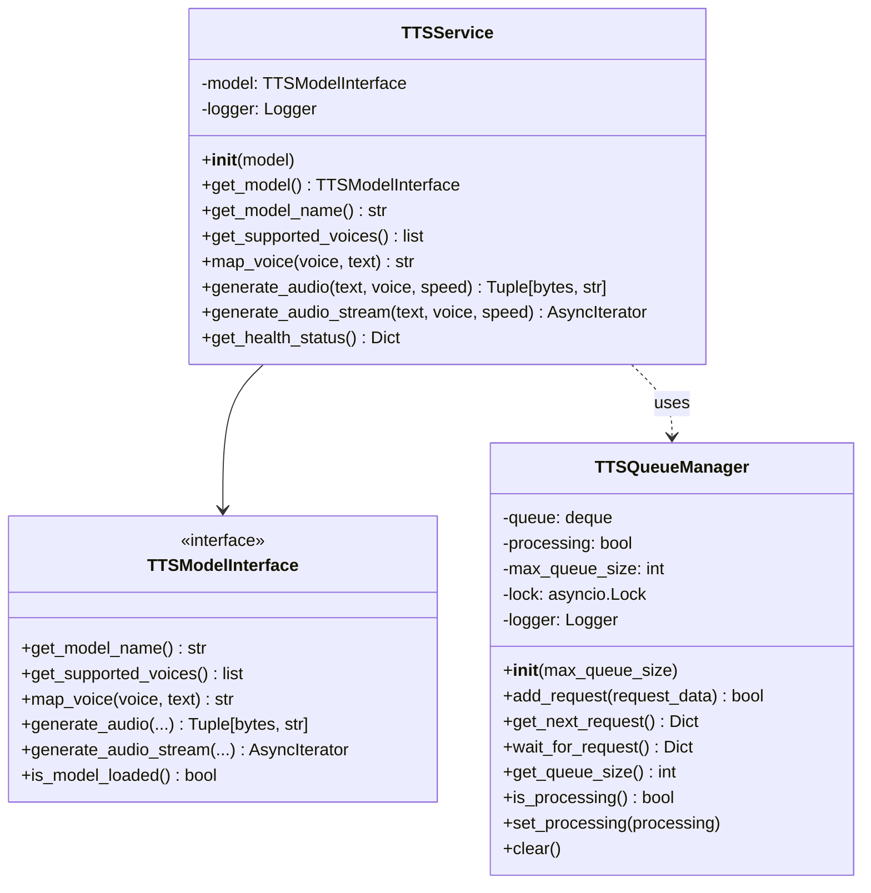
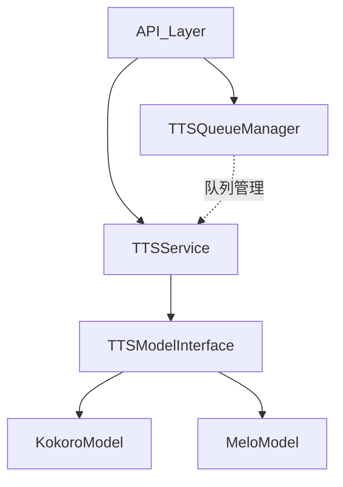
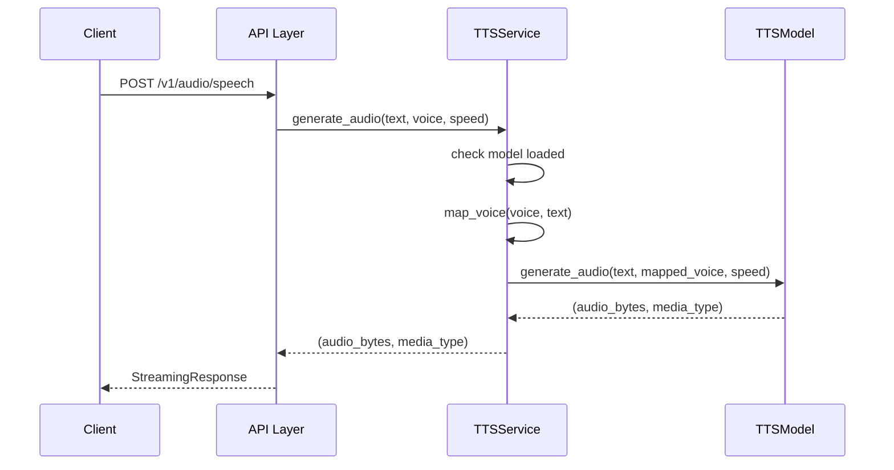
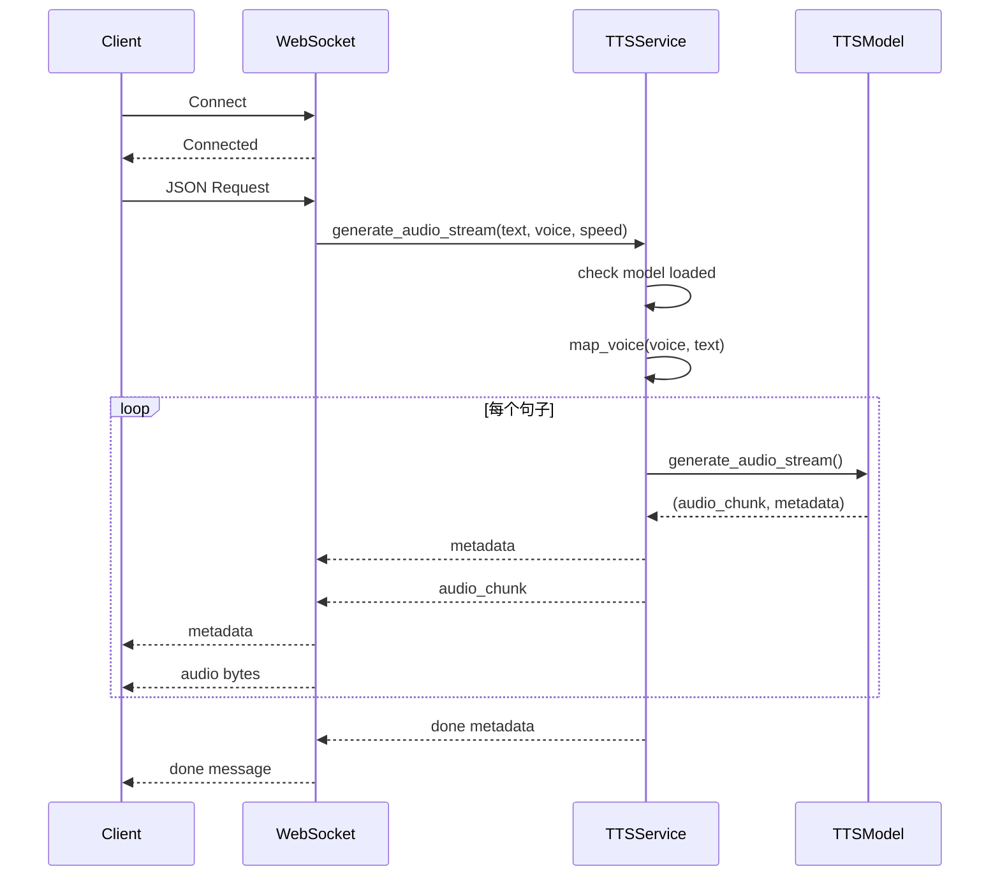

# 服务类设计文档

本文档详细说明服务层的类设计和实现细节。

## 📋 目录

- [TTSService 类](#ttsservice-类)
- [TTSQueueManager 类](#ttsqueuemanager-类)
- [类关系图](#类关系图)
- [使用示例](#使用示例)

---

## TTSService 类

### 类定义

**文件**: `services/tts_service.py`

```python
class TTSService:
    """TTS 服务编排器"""
```

### 核心职责

- 封装 `TTSModelInterface` 实例
- 提供统一的音频生成接口
- 处理音色映射和验证
- 连接 API 层和模型层
- 错误处理和日志记录

### 类属性

```python
model: TTSModelInterface      # TTS 模型实例
logger: logging.Logger        # 日志记录器
```

### 关键方法详解

#### 1. __init__()

```python
def __init__(self, model: TTSModelInterface):
    """
    初始化 TTS 服务

    Args:
        model: TTS 模型实例
    """
    self.model = model
    self.logger = logging.getLogger(self.__class__.__name__)
```

**作用**: 初始化服务，注入模型实例

**设计模式**: 依赖注入（Dependency Injection）

#### 2. get_model()

```python
def get_model(self) -> TTSModelInterface:
    """
    获取底层模型实例

    Returns:
        TTS 模型实例
    """
    return self.model
```

**作用**: 暴露底层模型，用于健康检查和模型操作

#### 3. get_model_name()

```python
def get_model_name(self) -> str:
    """
    获取模型名称

    Returns:
        模型名称
    """
    return self.model.get_model_name()
```

**作用**: 获取当前使用的模型名称

#### 4. get_supported_voices()

```python
def get_supported_voices(self) -> list:
    """
    获取支持的音色列表

    Returns:
        音色列表
    """
    return self.model.get_supported_voices()
```

**作用**: 获取模型支持的所有音色

#### 5. map_voice()

```python
def map_voice(self, requested_voice: str, text: str) -> str:
    """
    映射音色

    Args:
        requested_voice: 请求的音色
        text: 文本（用于语言检测和音色优化）

    Returns:
        映射后的音色

    Raises:
        InvalidVoiceError: 音色无效
    """
    # 检查音色是否有效
    supported_voices = self.model.get_supported_voices()
    openai_voices = ["alloy", "echo", "fable", "onyx", "nova", "shimmer"]

    if requested_voice not in supported_voices and requested_voice not in openai_voices:
        raise InvalidVoiceError(requested_voice, supported_voices + openai_voices)

    return self.model.map_voice(requested_voice, text)
```

**作用**:
- 验证请求的音色是否有效
- 将 OpenAI 风格的音色映射到模型特定音色
- 根据文本语言优化音色选择

**验证逻辑**:
```
请求的音色 → 检查是否在支持列表中 → 映射到模型音色 → 返回映射结果
```

#### 6. generate_audio()

```python
async def generate_audio(
    self,
    text: str,
    voice: str,
    speed: float = 1.0,
    **kwargs
) -> Tuple[bytes, str]:
    """
    生成音频

    Args:
        text: 输入文本
        voice: 音色
        speed: 语速
        **kwargs: 其他参数

    Returns:
        (audio_bytes, media_type) 元组

    Raises:
        InvalidVoiceError: 音色无效
        ModelNotLoadedError: 模型未加载
        TTSError: 其他错误
    """
    # 1. 检查模型加载策略
    from core.tts_interface import ModelLoadingStrategy

    # 对于 EAGER 加载策略的模型，检查是否已加载
    if self.model.get_loading_strategy() == ModelLoadingStrategy.EAGER:
        if not self.model.is_model_loaded():
            raise ModelNotLoadedError(self.model.get_model_name())

    # 2. 映射音色
    mapped_voice = self.map_voice(voice, text)

    try:
        # 3. 调用模型生成音频
        return await self.model.generate_audio(
            text=text,
            voice=mapped_voice,
            speed=speed,
            **kwargs
        )
    except TTSError:
        raise
    except Exception as e:
        self.logger.error(f"Failed to generate audio: {e}")
        raise AudioGenerationError(str(e))
```

**处理流程**:
```
检查模型加载策略 → 映射音色 → 调用模型 → 错误处理 → 返回结果
```

**错误处理**:
- `ModelNotLoadedError`: 模型未加载
- `InvalidVoiceError`: 音色无效
- `AudioGenerationError`: 音频生成失败

#### 7. generate_audio_stream()

```python
async def generate_audio_stream(
    self,
    text: str,
    voice: str,
    speed: float = 1.0,
    **kwargs
) -> AsyncIterator[Tuple[bytes, dict]]:
    """
    生成流式音频

    Args:
        text: 输入文本
        voice: 音色
        speed: 语速
        **kwargs: 其他参数

    Yields:
        (audio_chunk, metadata) 元组

    Raises:
        InvalidVoiceError: 音色无效
        ModelNotLoadedError: 模型未加载
        TTSError: 其他错误
    """
    # 1. 检查模型加载策略
    from core.tts_interface import ModelLoadingStrategy

    # 对于 EAGER 加载策略的模型，检查是否已加载
    if self.model.get_loading_strategy() == ModelLoadingStrategy.EAGER:
        if not self.model.is_model_loaded():
            raise ModelNotLoadedError(self.model.get_model_name())

    # 2. 映射音色
    mapped_voice = self.map_voice(voice, text)

    try:
        # 3. 流式生成音频
        async for chunk, metadata in self.model.generate_audio_stream(
            text=text,
            voice=mapped_voice,
            speed=speed,
            **kwargs
        ):
            yield chunk, metadata
    except TTSError:
        raise
    except Exception as e:
        self.logger.error(f"Failed to generate audio stream: {e}")
        raise AudioGenerationError(str(e))
```

**流式处理流程**:
```
检查模型加载策略 → 映射音色 → 逐句生成 → 流式返回 → 错误处理
```

**元数据格式**:
```python
{
    "type": "sentence_start|sentence_end|done",
    "index": int,
    "text": str,
    "voice": str,
    "total_sentences": int
}
```

#### 8. get_health_status()

```python
def get_health_status(self) -> Dict[str, Any]:
    """
    获取健康状态

    Returns:
        健康状态字典
    """
    return {
        "model": self.model.get_model_name(),
        "model_loaded": self.model.is_model_loaded(),
        "supported_voices": self.model.get_supported_voices(),
    }
```

**作用**: 提供服务健康状态信息

**返回格式**:
```json
{
  "model": "kokoro",
  "model_loaded": true,
  "supported_voices": ["af_heart", "af_maple", ...]
}
```

### 工厂函数

```python
def create_tts_service(model: TTSModelInterface) -> TTSService:
    """
    创建 TTS 服务实例

    Args:
        model: TTS 模型实例

    Returns:
        TTS 服务实例
    """
    return TTSService(model)
```

**作用**: 工厂函数，创建 TTSService 实例

### 使用示例

#### 创建服务实例

```python
from models import get_model_class
from services import create_tts_service
from config import settings

# 创建模型
ModelClass = get_model_class(settings.tts_model)
model = ModelClass()

# 初始化模型（如果是 eager loading）
if model.get_loading_strategy() == ModelLoadingStrategy.EAGER:
    model.initialize_model()

# 创建服务
tts_service = create_tts_service(model)
```

#### 生成音频

```python
# 生成音频
audio_bytes, media_type = await tts_service.generate_audio(
    text="Hello, world!",
    voice="alloy",
    speed=1.0
)

# 保存到文件
with open("output.mp3", "wb") as f:
    f.write(audio_bytes)
```

#### 流式生成

```python
# 流式生成音频
async for chunk, metadata in tts_service.generate_audio_stream(
    text="This is a long text that will be split into sentences.",
    voice="alloy",
    speed=1.0
):
    if chunk:
        # 处理音频块
        process_audio(chunk)

    if metadata:
        # 处理元数据
        print(f"Metadata: {metadata}")
```

#### 获取健康状态

```python
# 获取健康状态
health = tts_service.get_health_status()
print(f"Model: {health['model']}")
print(f"Model Loaded: {health['model_loaded']}")
print(f"Supported Voices: {health['supported_voices']}")
```

---

## TTSQueueManager 类

### 类定义

**文件**: `services/queue_manager.py`

```python
class TTSQueueManager:
    """TTS 请求队列管理器"""
```

### 核心职责

- 管理并发 TTS 请求
- 防止资源冲突
- 限制队列大小
- FIFO（先进先出）请求处理

### 类属性

```python
queue: deque                    # 请求队列（双端队列）
processing: bool                # 是否正在处理请求
max_queue_size: int            # 最大队列大小
lock: asyncio.Lock             # 异步锁
logger: logging.Logger         # 日志记录器
```

### 关键方法详解

#### 1. __init__()

```python
def __init__(self, max_queue_size: int = 100):
    """
    初始化队列管理器

    Args:
        max_queue_size: 最大队列大小
    """
    self.queue = deque()
    self.processing = False
    self.max_queue_size = max_queue_size
    self.lock = asyncio.Lock()
    self.logger = logging.getLogger(self.__class__.__name__)
```

**作用**: 初始化队列管理器

**默认值**: `max_queue_size = 100`

#### 2. add_request()

```python
async def add_request(self, request_data: Dict[str, Any]) -> bool:
    """
    添加请求到队列

    Args:
        request_data: 请求数据

    Returns:
        是否成功添加
    """
    async with self.lock:
        if len(self.queue) >= self.max_queue_size:
            self.logger.warning("Queue is full, rejecting request")
            return False
        self.queue.append(request_data)
        self.logger.info(f"Request added to queue. Queue size: {len(self.queue)}")
        return True
```

**作用**: 将请求添加到队列

**返回值**:
- `True`: 成功添加
- `False`: 队列已满，拒绝添加

**请求数据格式**:
```python
{
    "text": "要合成的文本",
    "voice": "alloy",
    "speed": 1.0,
    "input_format": "plain"
}
```

#### 3. get_next_request()

```python
async def get_next_request(self) -> Optional[Dict[str, Any]]:
    """
    获取队列中的下一个请求

    Returns:
        请求数据或 None
    """
    async with self.lock:
        if self.queue:
            return self.queue.popleft()
        return None
```

**作用**: 从队列头部取出下一个请求（FIFO）

**返回值**:
- 请求数据: 队列不为空
- `None`: 队列为空

#### 4. wait_for_request()

```python
async def wait_for_request(self) -> Optional[Dict[str, Any]]:
    """
    等待下一个请求（阻塞）

    Returns:
        请求数据或 None
    """
    while True:
        request = await self.get_next_request()
        if request:
            return request
        await asyncio.sleep(0.1)
```

**作用**: 阻塞等待下一个请求，用于后台处理

**使用场景**: 持续监听队列的处理循环

#### 5. get_queue_size()

```python
def get_queue_size(self) -> int:
    """
    获取当前队列大小

    Returns:
        队列大小
    """
    return len(self.queue)
```

**作用**: 获取当前队列中的请求数量

#### 6. is_processing()

```python
def is_processing(self) -> bool:
    """
    检查是否正在处理请求

    Returns:
        是否正在处理
    """
    return self.processing
```

**作用**: 检查处理状态

#### 7. set_processing()

```python
def set_processing(self, processing: bool) -> None:
    """
    设置处理状态

    Args:
        processing: 处理状态
    """
    self.processing = processing
```

**作用**: 设置处理状态标志

#### 8. clear()

```python
async def clear(self) -> None:
    """清空队列"""
    async with self.lock:
        self.queue.clear()
        self.logger.info("Queue cleared")
```

**作用**: 清空队列，用于重置或错误恢复

### 全局实例管理

```python
# 全局队列管理器实例
_global_queue_manager: Optional[TTSQueueManager] = None

def get_queue_manager() -> TTSQueueManager:
    """
    获取全局队列管理器实例

    Returns:
        队列管理器实例
    """
    global _global_queue_manager
    if _global_queue_manager is None:
        _global_queue_manager = TTSQueueManager()
    return _global_queue_manager

def set_queue_manager(manager: TTSQueueManager) -> None:
    """
    设置全局队列管理器实例

    Args:
        manager: 队列管理器实例
    """
    global _global_queue_manager
    _global_queue_manager = manager
```

**设计模式**: 单例模式（Singleton Pattern）

### 使用示例

#### 获取队列管理器

```python
from services.queue_manager import get_queue_manager

# 获取全局队列管理器
queue_manager = get_queue_manager()
```

#### 添加请求

```python
# 添加请求到队列
request_data = {
    "text": "Hello, world!",
    "voice": "alloy",
    "speed": 1.0
}

success = await queue_manager.add_request(request_data)
if success:
    print("Request added to queue")
else:
    print("Queue is full")
```

#### 处理队列

```python
# 后台处理队列
async def process_queue():
    while True:
        # 获取下一个请求
        request = await queue_manager.wait_for_request()
        if request:
            # 处理请求
            await process_request(request)
```

#### 获取队列状态

```python
# 获取队列大小
size = queue_manager.get_queue_size()
print(f"Queue size: {size}")

# 检查处理状态
processing = queue_manager.is_processing()
print(f"Processing: {processing}")
```

#### 清空队列

```python
# 清空队列
await queue_manager.clear()
print("Queue cleared")
```

### 配置

#### 环境变量

```ini
# .env
MAX_QUEUE_SIZE=100
```

#### 配置文件

```python
# config/settings.py
max_queue_size: int = 100
```

---

## 类关系图

### UML 类图



### 依赖关系图



### 交互序列图

#### HTTP 请求流程



#### WebSocket 流式请求流程



---

## 使用示例

### 完整的服务创建和使用

```python
import asyncio
from models import get_model_class
from services import create_tts_service, get_queue_manager
from config import settings

async def main():
    # 1. 创建模型
    ModelClass = get_model_class(settings.tts_model)
    model = ModelClass()

    # 2. 初始化模型（如果是 eager loading）
    if model.get_loading_strategy() == ModelLoadingStrategy.EAGER:
        model.initialize_model()

    # 3. 创建服务
    tts_service = create_tts_service(model)

    # 4. 获取队列管理器
    queue_manager = get_queue_manager()

    # 5. 生成音频
    try:
        audio_bytes, media_type = await tts_service.generate_audio(
            text="Hello, world!",
            voice="alloy",
            speed=1.0
        )

        # 保存音频
        with open("output.mp3", "wb") as f:
            f.write(audio_bytes)

        print("Audio generated successfully")

    except InvalidVoiceError as e:
        print(f"Invalid voice: {e.message}")
    except ModelNotLoadedError as e:
        print(f"Model not loaded: {e.message}")
    except Exception as e:
        print(f"Error: {e}")

    # 6. 检查健康状态
    health = tts_service.get_health_status()
    print(f"Health Status: {health}")

    # 7. 清理
    model.cleanup()

if __name__ == "__main__":
    asyncio.run(main())
```

### 流式音频生成

```python
async def stream_audio_example():
    # 创建服务
    model = get_model_class(settings.tts_model)()
    model.initialize_model()
    tts_service = create_tts_service(model)

    # 流式生成音频
    async for chunk, metadata in tts_service.generate_audio_stream(
        text="This is a long text that will be split into sentences. "
             "Each sentence will be processed separately.",
        voice="alloy",
        speed=1.0
    ):
        if metadata:
            print(f"Metadata: {metadata['type']} - {metadata.get('text', '')}")
        if chunk:
            print(f"Received audio chunk: {len(chunk)} bytes")

    # 清理
    model.cleanup()
```

### 队列管理

```python
async def queue_management_example():
    # 获取队列管理器
    queue_manager = get_queue_manager()

    # 添加多个请求
    requests = [
        {"text": "First request", "voice": "alloy"},
        {"text": "Second request", "voice": "echo"},
        {"text": "Third request", "voice": "fable"}
    ]

    for req in requests:
        success = await queue_manager.add_request(req)
        print(f"Request added: {success}")

    # 处理队列
    queue_manager.set_processing(True)
    while queue_manager.get_queue_size() > 0:
        request = await queue_manager.get_next_request()
        if request:
            print(f"Processing: {request['text']}")
            # 处理请求...

    queue_manager.set_processing(False)
    print("All requests processed")
```

---

## 相关文档

- [核心类设计](04_class_design_core.md)
- [模型类设计](05_class_design_models.md)
- [API 类设计](07_class_design_api.md)
- [架构设计](03_architecture_design.md)
